<p align="center">
  <picture>
    <source media="(prefers-color-scheme: dark)" srcset="docs/assets/brand/banner-dark.svg">
    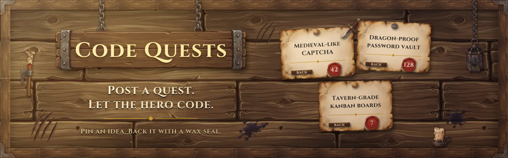
  </picture>
</p>

<p align="center">
  <a href="https://github.com/kfeuerschvenger/code-quests/actions/workflows/ci.yml"></a>
  <a href="LICENSE"></a>
  
  
  
  
  
  
  
</p>

<p align="center"><strong>English</strong> · <a href="README_es.md">Español</a></p>

<p align="center">
  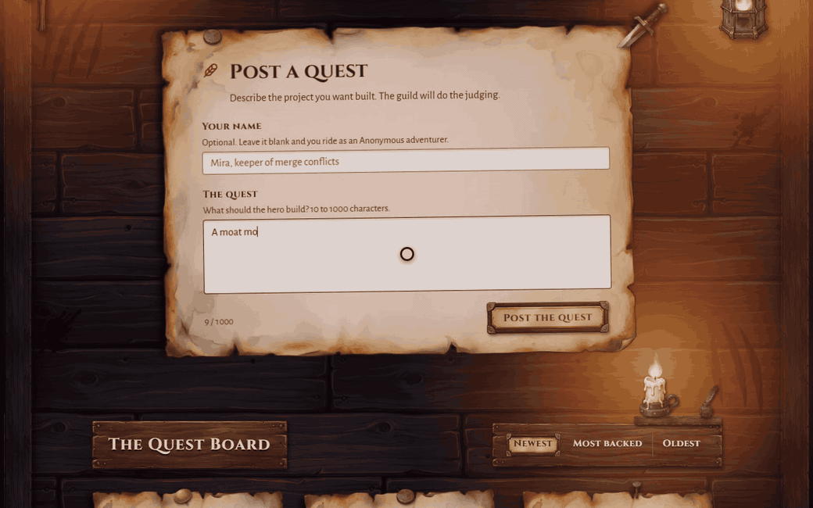
</p>

**Code Quests is a quest board for programming ideas: post one, and let the realm back it or reject it.**

Every idea is a parchment pinned to a wooden board. Visitors back a quest or reject it, and the score is stamped in wax. There are no accounts and no sign-ups: a hashed, anonymous voter identity keeps it to one vote per person per quest.

By day the sun climbs over the board. By night a torch, a lantern and a candle take over, and their light flickers across every parchment.

It began as a portfolio that was not one. Back then its author had none, so the site doubled as a pseudo-portfolio while visitors suggested the projects they wanted to see built. That portfolio now lives at [feuerschvenger.com](https://feuerschvenger.com/), and the board stays on for the quests still waiting for a hero.

## Take the tour

<table>
  <tr>
    <td width="50%" valign="top">
      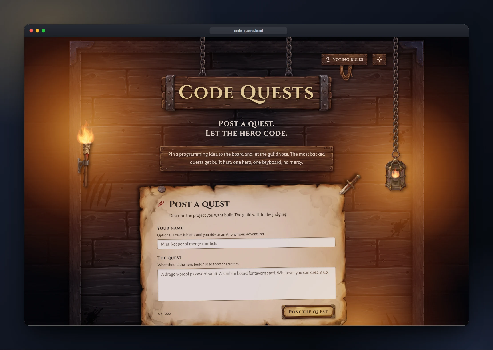
      <p><strong>Candle-lit tavern.</strong> A torch, a lantern and a candle light the board by night, and the fire flickers on every parchment.</p>
    </td>
    <td width="50%" valign="top">
      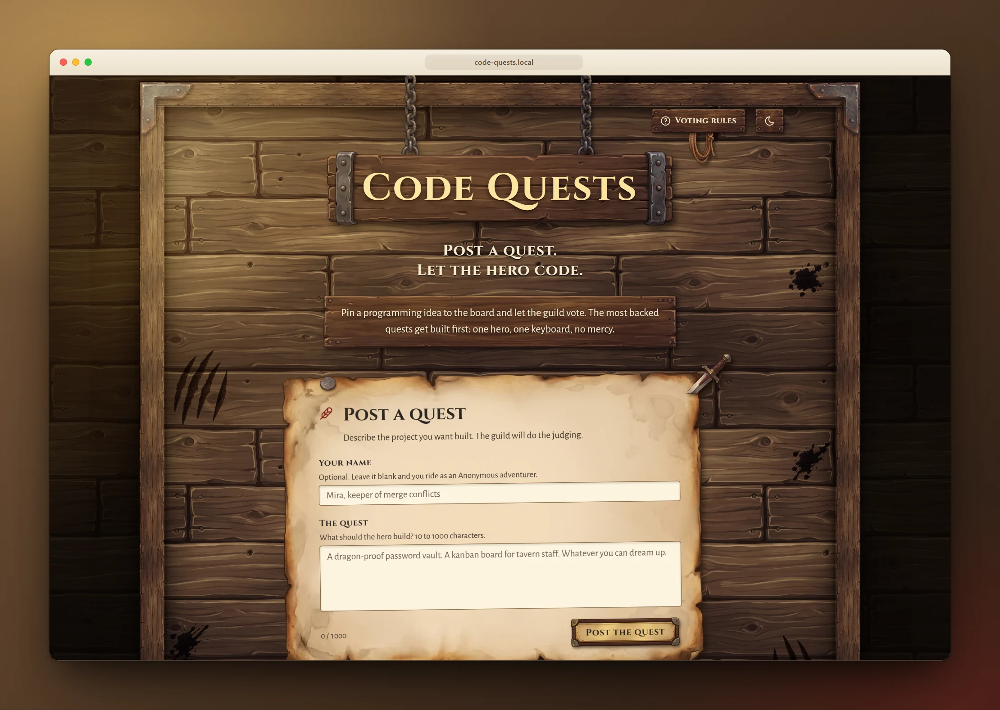
      <p><strong>Sunlight on the board.</strong> By day the light comes from the top left, and the same board looks like a different room.</p>
    </td>
  </tr>
  <tr>
    <td width="50%" valign="top">
      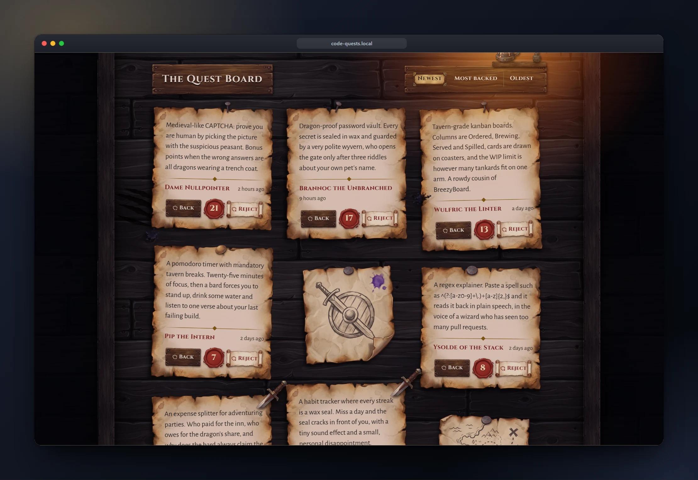
      <p><strong>Every quest, pinned.</strong> Parchments of any length settle into a masonry layout, each with its score stamped in a wax seal.</p>
    </td>
    <td width="50%" valign="top">
      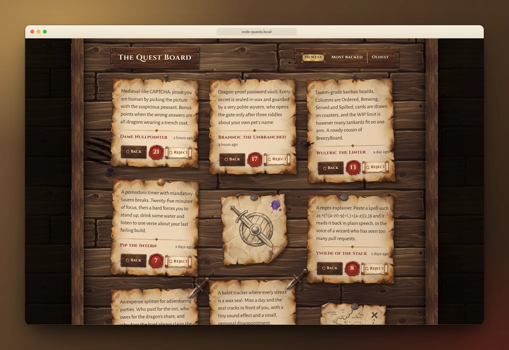
      <p><strong>Back it or reject it.</strong> One click backs a quest, another rejects it, and the seal changes at once, before the server has even answered.</p>
    </td>
  </tr>
  <tr>
    <td width="50%" valign="top">
      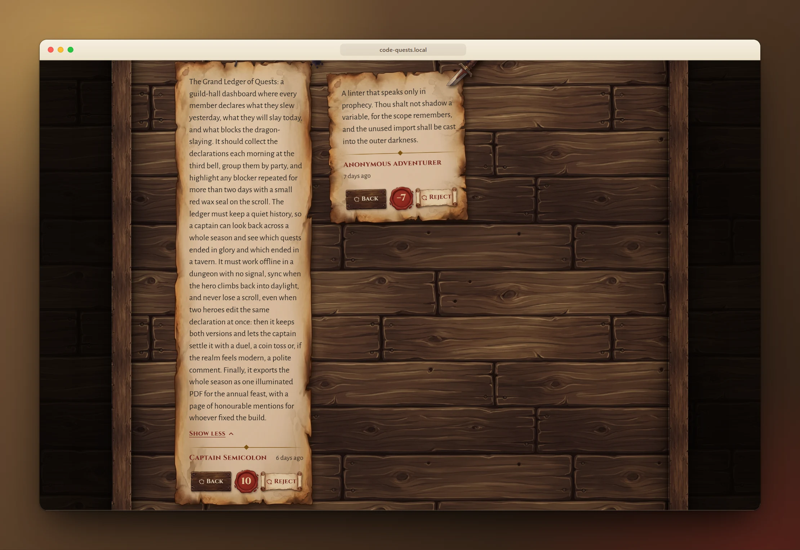
      <p><strong>Long tales welcome.</strong> A quest that runs long folds behind Read more, so one epic never hogs the board.</p>
    </td>
    <td width="50%" valign="top">
      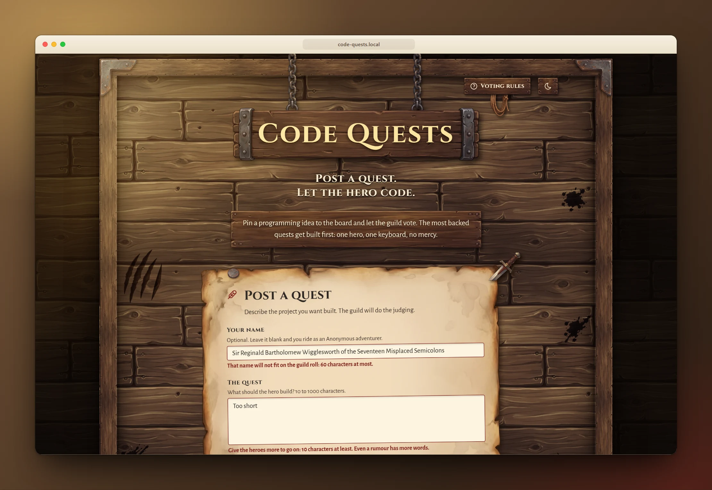
      <p><strong>Errors that explain themselves.</strong> The form says what is wrong with each field before anything is sent to the server.</p>
    </td>
  </tr>
  <tr>
    <td width="50%" valign="top">
      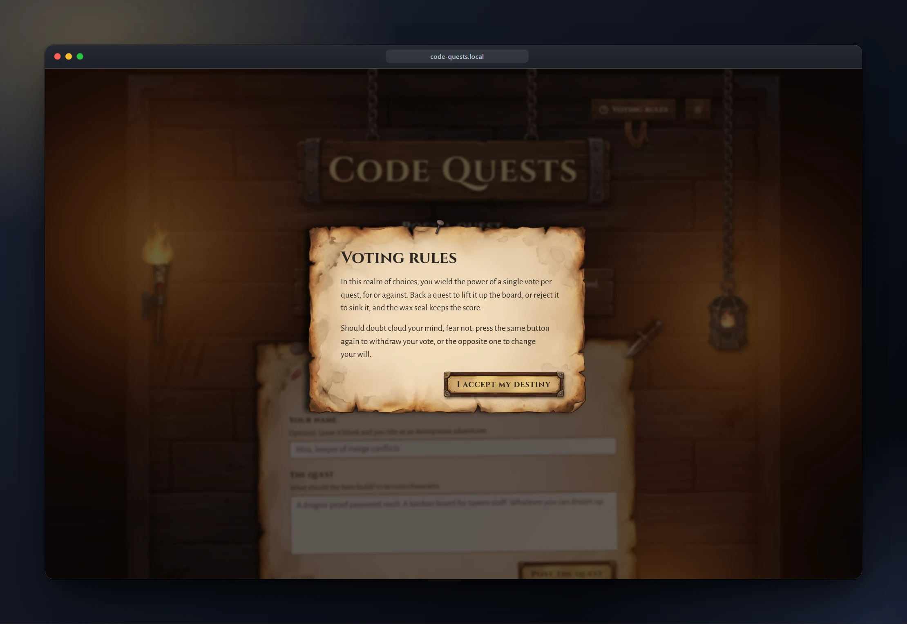
      <p><strong>Know the rules of the realm.</strong> One vote per quest, switch it or withdraw it whenever you like, all explained in the guild's own voice.</p>
    </td>
    <td width="50%" valign="top">
      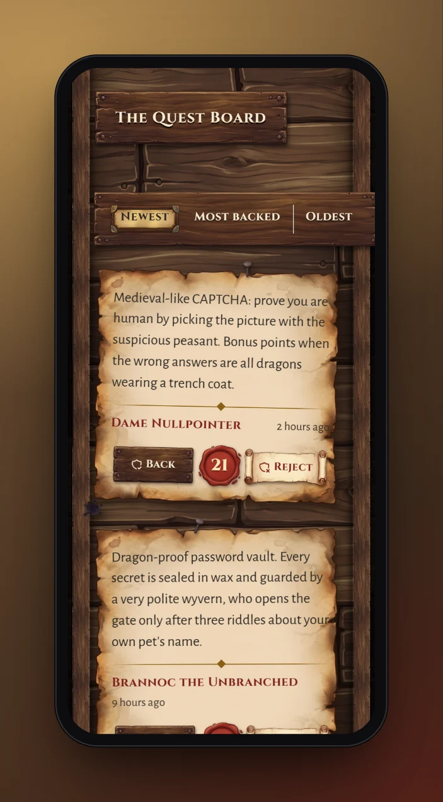&nbsp;
      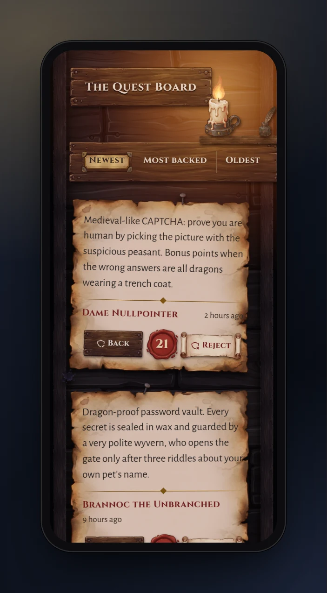
      <p><strong>Pocket-sized adventures.</strong> The board fits a phone in sun or candlelight, and the fire slows down to save the battery.</p>
    </td>
  </tr>
</table>

### What makes it special

- **No accounts, still one voter, one vote.** The server hashes the visitor's address with a secret, stores only the hash, and never trusts a header the client can forge.
- **Transactional votes.** A row lock and a unique constraint keep every score equal to the sum of its votes, even under a crowd.
- **Rate limited.** Posting and voting have their own allowances, and a limited call says how long to wait.
- **Day and night, with live firelight.** The scene follows your colour scheme, and the fire stands still under reduced motion.
- **Accessible and tested.** A live region announces votes, the fire respects reduced motion, and both halves run behind coverage gates in CI.
- **Reproducible screenshots.** Every picture here is taken by a script against a seeded demo, so they can be retaken after every change.

A vote takes this road, and the database has the last word:

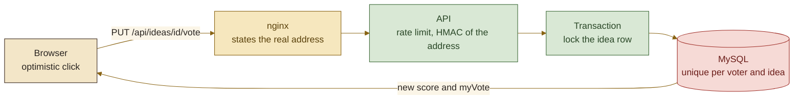

## Under the hood

<picture>
  <source media="(prefers-color-scheme: dark)" srcset="docs/assets/diagrams/architecture-dark.svg">
  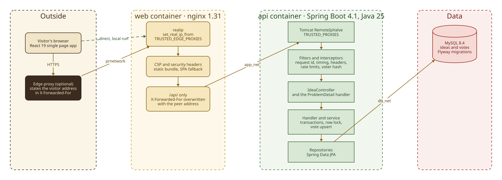
</picture>

A React single page app is served by nginx, which proxies only `/api` to a layered Spring Boot API: controller, handler, service, repository. MySQL holds the data under Flyway migrations, two private Docker networks plus an edge network keep the database out of reach, because it is attached only to `db_net`, and the trusted proxy chain decides whose word counts about the visitor's address.

<p align="center">
  &nbsp;
  &nbsp;
  &nbsp;
  &nbsp;
  &nbsp;
  &nbsp;
  &nbsp;
  &nbsp;
  
</p>

## Quick start

All you need is Docker, running.

```bash
git clone https://github.com/kfeuerschvenger/code-quests.git && cd code-quests
cp .env.example .env
docker compose up -d --build
```

Fill in `.env` before the last command: the database names and passwords, and a `VOTER_HASH_SECRET` of at least 32 bytes.

> [!TIP]
> The production compose does not publish the web port. To open the board on your own machine, add a `docker-compose.override.yml` that maps `127.0.0.1:8081:80` on the `web` service, and visit http://localhost:8081. That file, every variable, the development flow and the demo stack are in [ENVIRONMENT.md](docs/ENVIRONMENT.md).

## Dive deeper

The README is the notice on the board. The deep docs are the guild's archives.

| Document | The hook |
|---|---|
| [Architecture](docs/ARCHITECTURE.md) | Backend layers, the voter identity chain, vote locking, the schema, the frontend and the scene |
| [Environment](docs/ENVIRONMENT.md) | Every variable, the compose services and networks, the proxy chain, and the dev and demo flows |
| [Testing](docs/TESTING.md) | Test levels, Testcontainers, the coverage gates and the pipeline that takes these screenshots |
| [CI](docs/CI.md) | The three jobs, Dependabot and the branch flow |
| [API](docs/API.md) | Every endpoint, error codes, rate limits and voter identity |
| [Roadmap](docs/ROADMAP.md) | The next quests, and what each one needs before it starts |
| [openapi.yaml](docs/openapi.yaml) | The full HTTP contract, exported from the running API |
| [Asset licences](docs/ASSETS-LICENSES.md) | Where every font, texture and generated image comes from |
| [Showcase guide](e2e/showcase/README.md) | How to retake the screenshots and the hero animation |

---

<p align="center">
  <strong>Forged in Argentina · where the quests outnumber the mate gourds</strong><br>
  Forged with care (and a few dragons slain) by <strong>Kevin Feuerschvenger</strong> · Software Engineer
</p>

<p align="center">
  <a href="https://github.com/kfeuerschvenger"></a>
  <a href="https://www.linkedin.com/in/kevin-feuerschvenger/"></a>
  <a href="https://feuerschvenger.com/"></a>
</p>

<p align="center"><sub>Released under the <a href="LICENSE">MIT licence</a>.</sub></p>
