<p align="center">
  <picture>
    <source media="(prefers-color-scheme: dark)" srcset="docs/assets/brand/banner-dark.svg">
    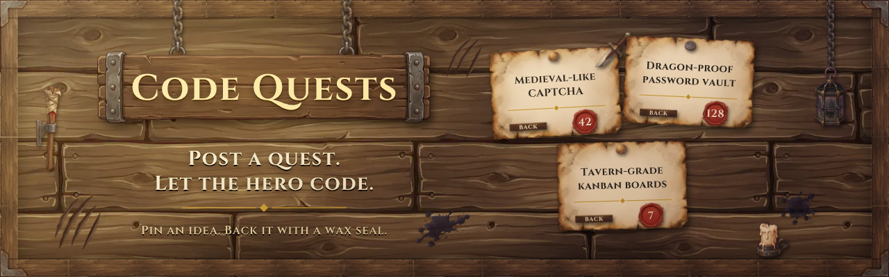
  </picture>
</p>

<p align="center">
  <a href="https://github.com/kfeuerschvenger/programmingrequests/actions/workflows/ci.yml"></a>
  <a href="LICENSE"></a>
  
  
  
  
  
  
  
</p>

<p align="center"><a href="README.md">English</a> · <strong>Español</strong></p>

<p align="center">
  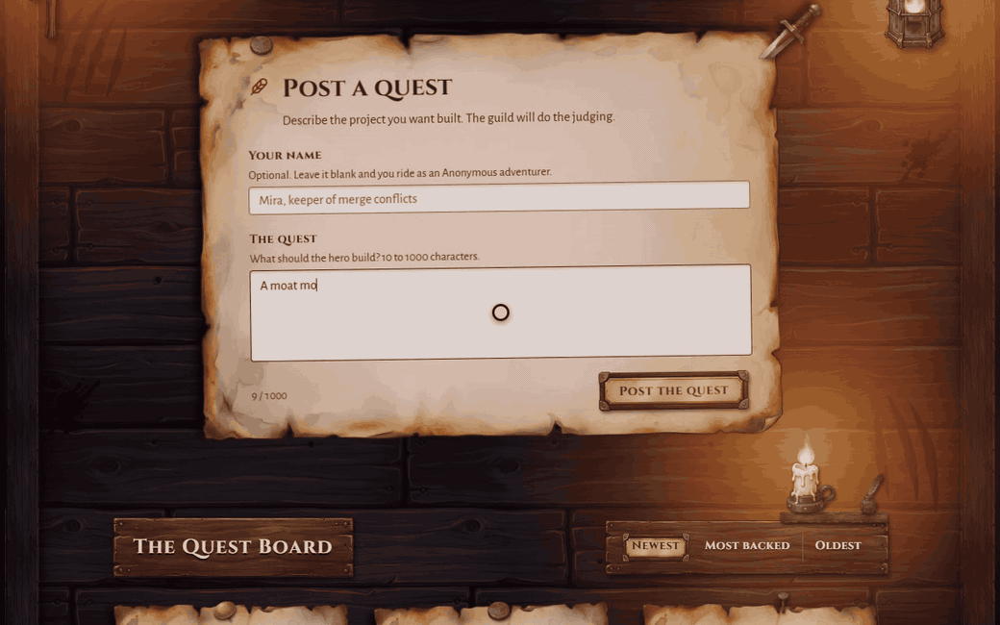
</p>

**Code Quests es un tablón de misiones para ideas de programación: publica una y deja que el reino la respalde o la rechace.**

Cada idea es un pergamino clavado en un tablón de madera. Los visitantes respaldan una misión o la rechazan, y el puntaje se estampa en lacre. No hay cuentas ni registros: una identidad de votante anónima y con hash garantiza un solo voto por persona y por misión.

De día, el sol recorre el tablón. De noche, una antorcha, un farol y una vela toman el relevo, y su luz titila sobre cada pergamino.

Empezó como un portfolio que no lo era. En ese momento su autor no tenía ninguno, así que el sitio hacía las veces de seudo-portfolio mientras los visitantes sugerían los proyectos que querían ver construidos. Ese portfolio hoy vive en [feuerschvenger.com](https://feuerschvenger.com/), y el tablón sigue en pie para las misiones que todavía esperan a su héroe.

## Recorrido

<table>
  <tr>
    <td width="50%" valign="top">
      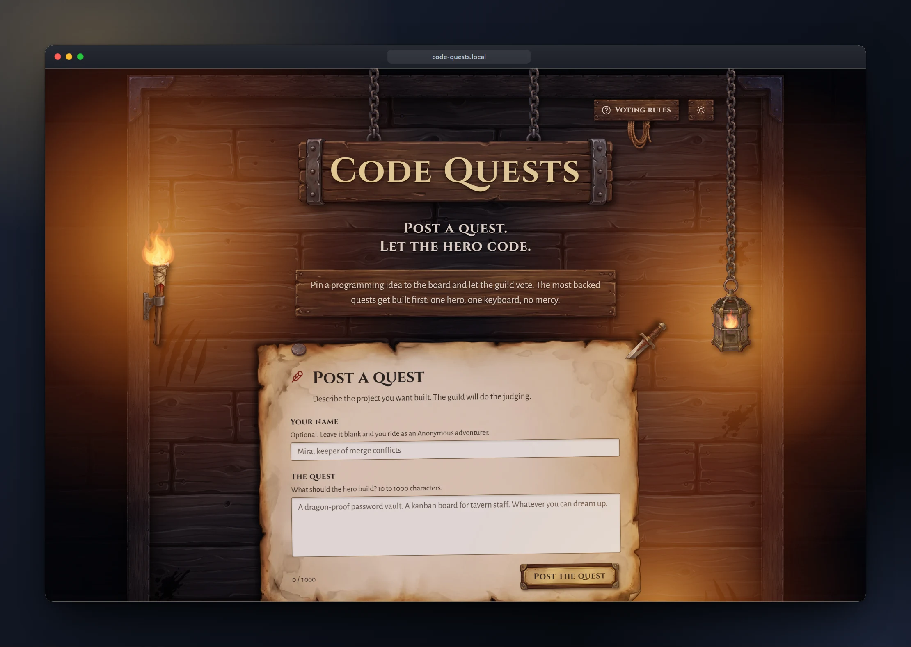
      <p><strong>Taberna a la luz de las velas.</strong> Una antorcha, un farol y una vela iluminan el tablón de noche, y el fuego titila sobre cada pergamino.</p>
    </td>
    <td width="50%" valign="top">
      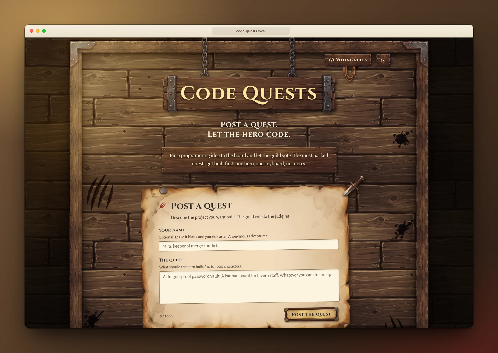
      <p><strong>Sol sobre el tablón.</strong> De día la luz llega desde arriba a la izquierda, y el mismo tablón parece otra sala.</p>
    </td>
  </tr>
  <tr>
    <td width="50%" valign="top">
      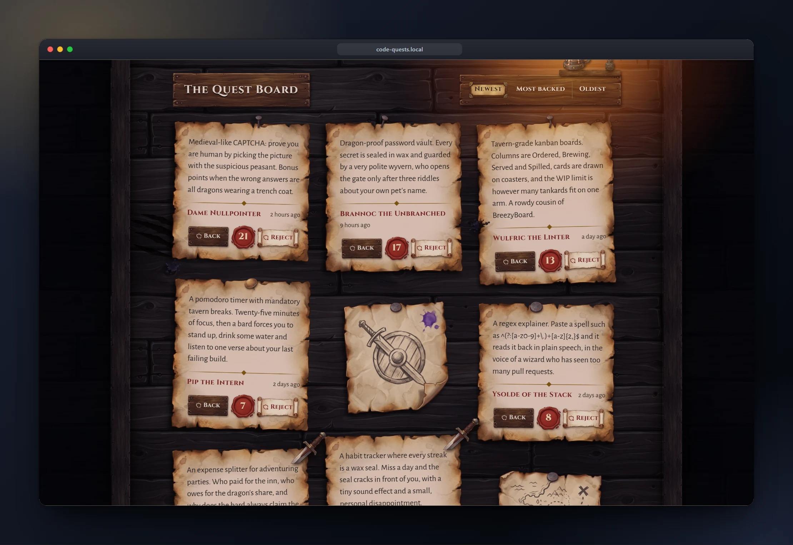
      <p><strong>Cada misión, clavada.</strong> Pergaminos de cualquier largo se acomodan en un mosaico, cada uno con su puntaje estampado en un sello de lacre.</p>
    </td>
    <td width="50%" valign="top">
      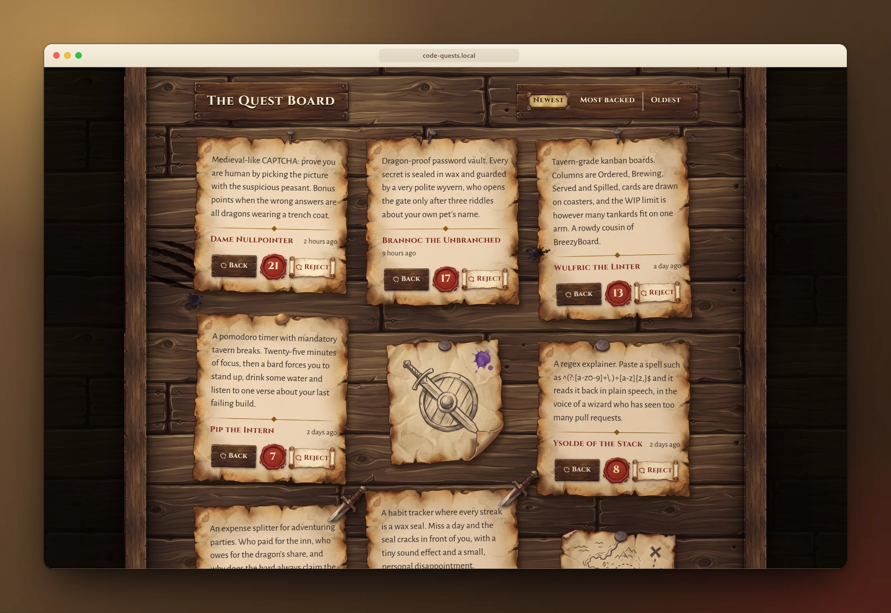
      <p><strong>Respáldala o recházala.</strong> Un clic respalda una misión, otro la rechaza, y el sello cambia al instante, antes de que el servidor responda.</p>
    </td>
  </tr>
  <tr>
    <td width="50%" valign="top">
      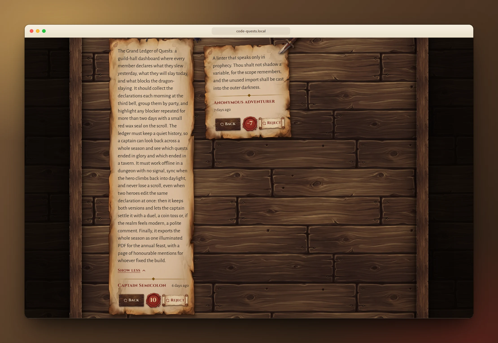
      <p><strong>Las historias largas son bienvenidas.</strong> Una misión extensa se pliega tras Read more, para que una sola epopeya no acapare el tablón.</p>
    </td>
    <td width="50%" valign="top">
      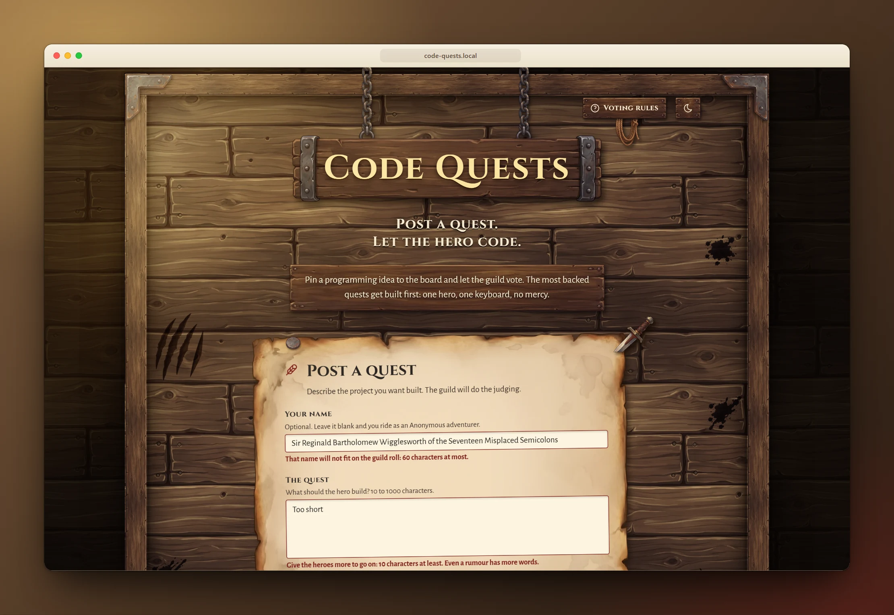
      <p><strong>Errores que se explican solos.</strong> El formulario indica qué falla en cada campo antes de enviar nada al servidor.</p>
    </td>
  </tr>
  <tr>
    <td width="50%" valign="top">
      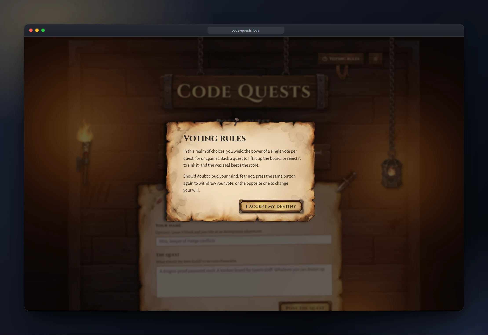
      <p><strong>Conoce las reglas del reino.</strong> Un voto por misión, que puedes cambiar o retirar cuando quieras, todo explicado con la voz del gremio.</p>
    </td>
    <td width="50%" valign="top">
      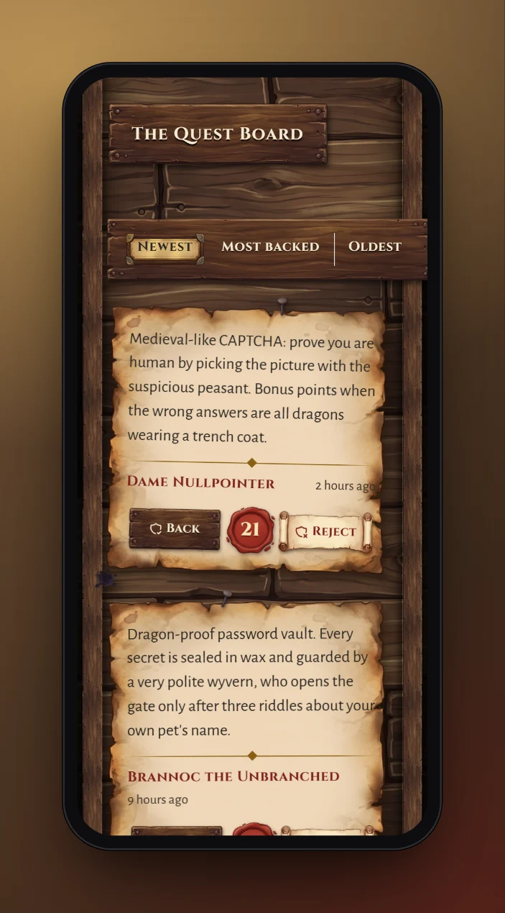&nbsp;
      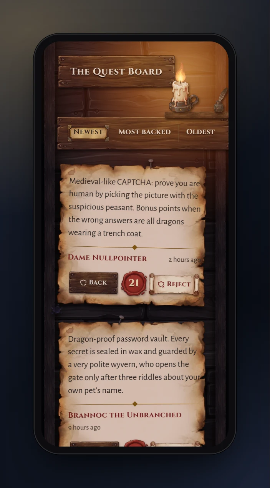
      <p><strong>Aventuras de bolsillo.</strong> El tablón cabe en un teléfono con sol o con velas, y el fuego baja el ritmo para ahorrar batería.</p>
    </td>
  </tr>
</table>

### Qué lo hace especial

- **Sin cuentas, pero un votante, un voto.** El servidor calcula un hash de la dirección del visitante con un secreto, guarda solo el hash y nunca confía en un encabezado que el cliente pueda falsificar.
- **Votos transaccionales.** Un bloqueo de fila y una restricción de unicidad mantienen cada puntaje igual a la suma de sus votos, incluso con mucha gente.
- **Con límite de frecuencia.** Publicar y votar tienen cupos propios, y una llamada limitada indica cuánto esperar.
- **Día y noche, con fuego en vivo.** La escena sigue tu esquema de color, y el fuego se detiene si se pide reducir el movimiento.
- **Accesible y probado.** Una región en vivo anuncia los votos, el fuego respeta el movimiento reducido y ambas mitades corren con umbrales de cobertura en CI.
- **Capturas reproducibles.** Cada imagen de aquí la toma un script contra una demo con datos fijos, así que pueden repetirse tras cada cambio.

Un voto recorre este camino, y la base de datos tiene la última palabra:

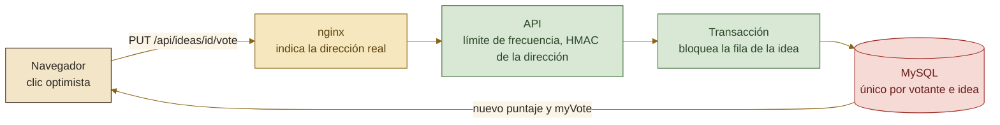

## Bajo el capó

<picture>
  <source media="(prefers-color-scheme: dark)" srcset="docs/assets/diagrams/architecture-dark.svg">
  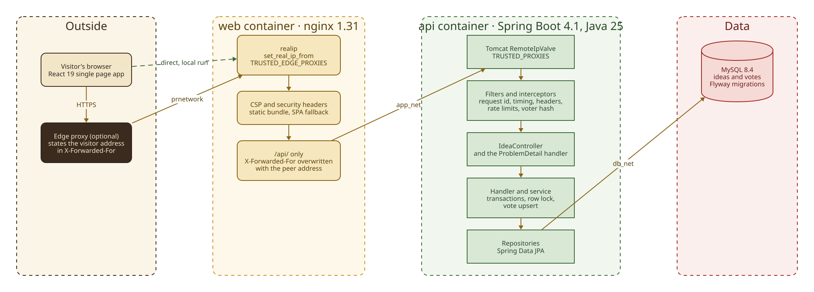
</picture>

Una aplicación de página única en React la sirve nginx, que reenvía solo `/api` a una API de Spring Boot en capas: controlador, handler, servicio y repositorio. MySQL guarda los datos con migraciones de Flyway, tres redes privadas de Docker mantienen la base de datos fuera de alcance y la cadena de proxies de confianza decide a quién se le cree la dirección del visitante.

<p align="center">
  &nbsp;
  &nbsp;
  &nbsp;
  &nbsp;
  &nbsp;
  &nbsp;
  &nbsp;
  &nbsp;
  
</p>

## Inicio rápido

Solo necesitas Docker en ejecución.

```bash
git clone https://github.com/kfeuerschvenger/programmingrequests.git && cd programmingrequests
cp .env.example .env
docker compose up -d --build
```

Completa `.env` antes del último comando: los nombres y contraseñas de la base de datos, y un `VOTER_HASH_SECRET` de al menos 32 bytes.

> [!TIP]
> El compose de producción no publica el puerto del servicio web. Para abrir el tablón en tu equipo, agrega un `docker-compose.override.yml` que mapee `127.0.0.1:8081:80` en el servicio `web` y visita http://localhost:8081. Ese archivo, todas las variables, el flujo de desarrollo y el stack de demostración están en [ENVIRONMENT.md](docs/ENVIRONMENT.md).

## Profundiza

El README es el aviso en el tablón. Los documentos técnicos son los archivos del gremio. Están escritos en inglés.

| Documento | Qué encontrarás |
|---|---|
| [Architecture](docs/ARCHITECTURE.md) | Las capas del backend, la cadena de identidad del votante, el bloqueo de votos, el esquema, el frontend y la escena |
| [Environment](docs/ENVIRONMENT.md) | Todas las variables, los servicios y redes de compose, la cadena de proxies y los flujos de desarrollo y demostración |
| [Testing](docs/TESTING.md) | Niveles de prueba, Testcontainers, los umbrales de cobertura y el pipeline que toma estas capturas |
| [CI](docs/CI.md) | Los tres trabajos, Dependabot y el flujo de ramas |
| [API](docs/API.md) | Cada endpoint, códigos de error, límites de frecuencia e identidad del votante |
| [Roadmap](docs/ROADMAP.md) | Las próximas misiones y lo que necesita cada una para comenzar |
| [openapi.yaml](docs/openapi.yaml) | El contrato HTTP completo, exportado de la API en ejecución |
| [Asset licences](docs/ASSETS-LICENSES.md) | De dónde sale cada tipografía, textura e imagen generada |
| [Showcase guide](e2e/showcase/README.md) | Cómo repetir las capturas y la animación principal |

---

<p align="center">
  <strong>Forjado en Argentina · donde las misiones nunca se acaban</strong><br>
  Forjado con dedicación (y unos cuantos dragones vencidos) por <strong>Kevin Feuerschvenger</strong> · Software Engineer
</p>

<p align="center">
  <a href="https://github.com/kfeuerschvenger"></a>
  <a href="https://www.linkedin.com/in/kevin-feuerschvenger/"></a>
  <a href="https://feuerschvenger.com/"></a>
</p>

<p align="center"><sub>Publicado bajo la <a href="LICENSE">licencia MIT</a>.</sub></p>
