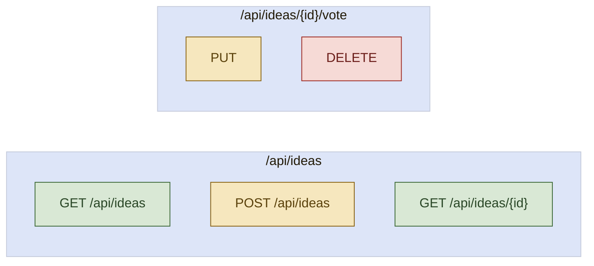

<picture>
  <source media="(prefers-color-scheme: dark)" srcset="assets/brand/header-strip-dark.png, assets/brand/header-strip-dark@2x.png 2x">
  
</picture>

# API

Five endpoints under `/api/ideas`, JSON in and out, errors as RFC 9457 problems. The full contract is [openapi.yaml](openapi.yaml), exported from the running API.



## Conventions

- Base path `/api`. In the Docker stack the site and the API share one origin, so the browser calls `/api` directly. The API itself is on `http://localhost:8080` (loopback only).
- Requests with a body send `Content-Type: application/json`. Unknown JSON properties are ignored, so a client can never set a score or a date.
- There are no accounts and no tokens. Voter identity is derived by the server, see [Voter identity](#voter-identity).
- Responses carry an `X-Request-Id` header. A client-sent `X-Request-Id` is kept when it matches `[A-Za-z0-9._-]{1,64}`.
- API responses are `Cache-Control: no-store`, and CORS is off unless `CORS_ALLOWED_ORIGINS` is set.
- Swagger UI (`/swagger-ui.html`) and the live document (`/api-docs`, `/api-docs.yaml`) exist only in the `dev` profile, on port 8080, not through nginx.

## Endpoints

| Method and path | Body | Success | Rate limited |
|---|---|---|---|
| `GET /api/ideas` | none | 200 `IdeaPageResponse` | No |
| `GET /api/ideas/{id}` | none | 200 `IdeaResponse` | No |
| `POST /api/ideas` | `CreateIdeaRequest` | 201 `IdeaResponse`, `Location: /api/ideas/{id}` | Yes, `CREATE_IDEA` |
| `PUT /api/ideas/{id}/vote` | `VoteRequest` | 200 `IdeaResponse` | Yes, `VOTE` |
| `DELETE /api/ideas/{id}/vote` | none | 200 `IdeaResponse` | Yes, `VOTE` |

### List quests

`GET /api/ideas?page=0&size=20&sort=newest`

| Parameter | Default | Rules |
|---|---|---|
| `page` | 0 | Zero-based, at least 0 |
| `size` | 20 | 1 to 50 |
| `sort` | `newest` | `newest`, `oldest` or `top`, case-insensitive. Ties break on the id, so pages are stable |

```json
{
  "items": [
    {
      "id": 1,
      "author": "Ada",
      "description": "A moat monitor for rising drawbridges.",
      "createdAt": "2026-11-10T01:40:11.960036Z",
      "score": 1,
      "myVote": 1
    }
  ],
  "page": 0,
  "size": 20,
  "totalItems": 1,
  "totalPages": 1
}
```

### Get one quest

`GET /api/ideas/{id}` answers an `IdeaResponse`, the item shape above, or 404 `IDEA_NOT_FOUND`.

| Field | Type | Meaning |
|---|---|---|
| `id` | integer | Quest id |
| `author` | string or null | Name, null when posted anonymously |
| `description` | string | The quest |
| `createdAt` | string | ISO-8601 instant in UTC |
| `score` | integer | Sum of all votes |
| `myVote` | integer | The caller's own vote: 1, -1, or 0 for none |

### Post a quest

`POST /api/ideas`

```json
{ "author": "Ada", "description": "A moat monitor for rising drawbridges." }
```

| Field | Rules |
|---|---|
| `description` | Required, 10 to 1000 characters after trimming |
| `author` | Optional, at most 60 characters. Blank becomes null, so the quest rides as anonymous |

The answer is 201 with the new `IdeaResponse` (score 0, `myVote` 0) and a `Location` header.

### Back or reject a quest

`PUT /api/ideas/{id}/vote` with `{ "value": 1 }` to back it or `{ "value": -1 }` to reject it. Any other value is a 400.

- No vote yet: the vote is stored and the score moves by the value.
- The opposite value: the vote switches and the score moves by two.
- The same value: nothing changes.

`DELETE /api/ideas/{id}/vote` withdraws the caller's vote and answers the `IdeaResponse` with `myVote` 0. It is idempotent: withdrawing a vote that does not exist is not an error. Both answer 404 `IDEA_NOT_FOUND` for an unknown id.

## ProblemDetail codes

Every error is `application/problem+json`. `detail` is a fixed sentence that never echoes the request, `instance` is `urn:request-id:<id>`, and `code` is stable, so clients should branch on it. The `type` member is left out of the body, since it would only carry the default `about:blank`.

```json
{
  "detail": "The request is not valid.",
  "instance": "urn:request-id:b6e8359d-9025-4ce9-a1f3-3cd4193892bc",
  "status": 400,
  "title": "Bad Request",
  "code": "VALIDATION_FAILED",
  "errors": [{ "field": "description", "message": "Must be between 10 and 1000 characters." }]
}
```

| `code` | Status | Cause |
|---|---|---|
| `VALIDATION_FAILED` | 400 | A body, parameter or path value is not valid. `errors` names each field, never its value |
| `MALFORMED_REQUEST` | 400 | The body is unreadable or has the wrong shape |
| `IDEA_NOT_FOUND` | 404 | No quest has that id |
| `RESOURCE_NOT_FOUND` | 404 | No such route |
| `METHOD_NOT_ALLOWED` | 405 | The path exists but not for that method |
| `NOT_ACCEPTABLE` | 406 | The `Accept` header cannot be satisfied |
| `CONFLICT` | 409 | A write collided with a concurrent one. Retrying is safe |
| `UNSUPPORTED_MEDIA_TYPE` | 415 | The body is not JSON |
| `RATE_LIMITED` | 429 | Too many writes. See below |
| `REQUEST_FAILED` | other 4xx | Any other client error |
| `INTERNAL_ERROR` | 500 | Anything else. The detail stays generic and the request id points at the log line |

## Rate limits

Only writes are limited, per client, with an allowance that refills in full at the end of each window.

| Scope | Covers | Default |
|---|---|---|
| `CREATE_IDEA` | `POST /api/ideas` | 5 per 10 minutes |
| `VOTE` | `PUT` and `DELETE` on `/api/ideas/{id}/vote` | 30 per minute |

A limited request is rejected before its body is validated and answers 429 with a `Retry-After` header in seconds and the same value as `retryAfterSeconds` in the body:

```json
{
  "detail": "Too many requests. Wait a little before trying again.",
  "instance": "urn:request-id:a761eada-15a8-43e4-bf36-a9c991abc76b",
  "status": 429,
  "title": "Too Many Requests",
  "code": "RATE_LIMITED",
  "retryAfterSeconds": 595
}
```

The limits come from `RATE_LIMIT_*` variables, see [ENVIRONMENT.md](ENVIRONMENT.md). State is in memory, so a limit applies per API instance.

## Voter identity

There is no login. The server hashes the visitor's network address with HMAC-SHA256 and a secret, and that hash is the voter: one voter has at most one vote per quest, enforced by a unique constraint. IPv6 visitors are grouped by their /64 prefix. The address itself is never stored and a header or body can never name a voter, so `myVote` is always the caller's own. The chain from the edge to the hash is explained in [ARCHITECTURE.md](ARCHITECTURE.md#voter-identity).

## OpenAPI

[openapi.yaml](openapi.yaml) is the document the API serves at `/api-docs.yaml`, with `servers` fixed at `http://localhost:8080`. `OpenApiExportTest` fails when the file drifts from the live document. To regenerate it, run from `backend/`:

```bash
./gradlew test --tests "*OpenApiExportTest" -Dopenapi.write=true
```

The run rewrites `docs/openapi.yaml` instead of asserting. It needs Docker, like the other `@SpringBootTest` classes.

---

[Back to the README](../README.md) · Previous: [CI](CI.md) · Next: [Roadmap](ROADMAP.md)
