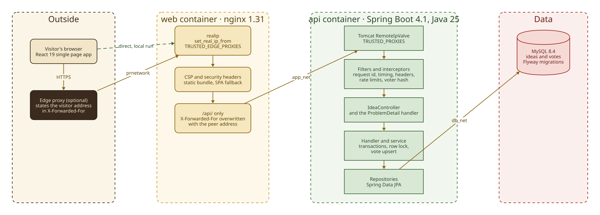
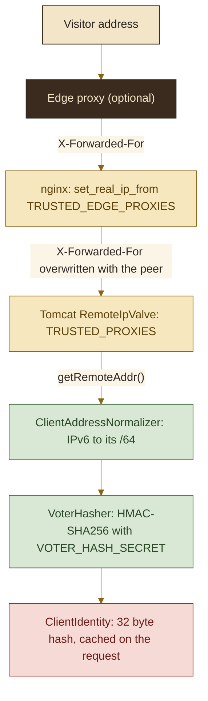
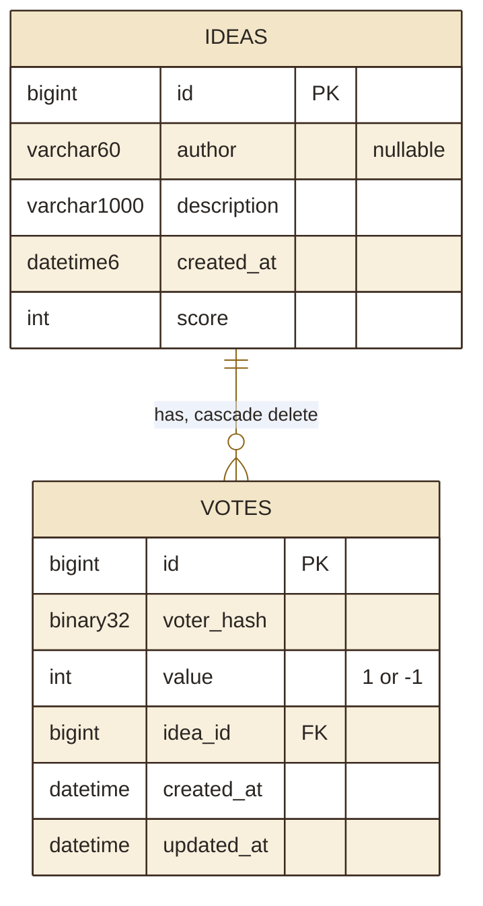

<picture>
  <source media="(prefers-color-scheme: dark)" srcset="assets/brand/header-strip-dark.png, assets/brand/header-strip-dark@2x.png 2x">
  
</picture>

# Architecture

How a vote travels from the browser to MySQL, which layer owns which decision, and how the board is lit. Every claim here was checked against the code.

The picture from the README, in full:

<picture>
  <source media="(prefers-color-scheme: dark)" srcset="assets/diagrams/architecture-dark.svg">
  
</picture>

## Backend layers

The base package is `com.feuerschvenger.codequests`. There is one resource, ideas, and one controller. Lombok supplies getters, protected constructors on entities and loggers. `spring.jpa.open-in-view` is off, so a lazy load outside a transaction fails by design.

| Layer | Classes | Rule |
|---|---|---|
| controller | `IdeaController` | Maps `/api/ideas`, reads the request, calls the handler. It never touches an address or a header. Holds the springdoc annotations |
| handler | `IdeaHandler`, `IdeaHandlerImpl` | Delegates to the service today. The place to orchestrate more than one service |
| service | `IdeaService`, `IdeaServiceImpl` | Transactions, locking, vote upsert and the score. Takes a voter hash, never an address |
| repository | `IdeaRepository`, `VoteRepository`, projection `IdeaVote` | Spring Data JPA, with a pessimistic write lock query and one query for the caller's votes on a page |
| mapper | `IdeaMapper` | Hand written conversions between entities and DTOs |
| model | `Idea`, `Vote`, `IdeaSort` | Entities, and the closed sort whitelist |
| DTOs | `CreateIdeaRequest`, `VoteRequest`, `IdeaResponse`, `IdeaPageResponse` | Java records with Jakarta Validation. Entities never leave the service |
| security | `ClientIdentityResolver`, `ClientAddressNormalizer`, `VoterHasher` | The voter identity chain, below |
| ratelimit | `RateLimiter`, `RateLimitInterceptor`, `RateLimitScope` | Bucket4j buckets held in Caffeine caches |
| exception | `GlobalExceptionHandler`, `ErrorCode` | Every failure becomes a ProblemDetail |
| util | `SecureLogger` | Log hardening: control characters stripped, arguments truncated, exceptions reduced to their class chain |

## Request pipeline

| Order | Component | Does |
|---|---|---|
| before the filters | Tomcat `RemoteIpValve` | Replaces the remote address with the `X-Forwarded-For` value only when the connecting peer matches `TRUSTED_PROXIES` |
| first | `MDCFilter` | Puts a request id in the log context and the `X-Request-Id` response header. A client-supplied id is kept only if it matches `[A-Za-z0-9._-]{1,64}`, otherwise a UUID takes its place |
| second | `RequestTimingFilter` | Logs the route template, the status and the duration. Skips the actuator and Swagger paths |
| third | `SecurityHeadersConfig` | `X-Content-Type-Options`, `X-Frame-Options: DENY`, `Referrer-Policy`, `Permissions-Policy`. API responses also get `Content-Security-Policy: default-src 'none'` and `Cache-Control: no-store` |
| MVC | `RateLimitInterceptor` | `POST /api/ideas` and the vote writes. Rejects before body validation |
| MVC | `CorsConfig` | Off unless `CORS_ALLOWED_ORIGINS` is set. Then exactly those origins, no credentials |

## Errors

`GlobalExceptionHandler` extends `ResponseEntityExceptionHandler`, so framework failures take the same path as application ones. Every error is an RFC 9457 `application/problem+json` with a stable `code`, a fixed `detail` text that never echoes input, and `instance` set to `urn:request-id:<id>`. The code table is in [API.md](API.md#problemdetail-codes).

> [!NOTE]
> Stack traces are suppressed on purpose outside the `dev` profile (`%nopex` in the log pattern), because exception messages can carry user input. Logs keep the first application frame and the cause chain by class name instead.

## Voter identity

The server decides who is voting. A request body, header or cookie never carries identity, and the address itself is never stored.

- nginx is configured with `real_ip_header X-Forwarded-For` and one `set_real_ip_from` per entry of `TRUSTED_EDGE_PROXIES`. With the list empty nobody is trusted: the client address is the TCP peer and a client-sent `X-Forwarded-For` is ignored.
- nginx then sets `X-Forwarded-For` to `$remote_addr` toward the API. The header is overwritten, never extended, so a forged value cannot reach the API.
- Tomcat trusts that header only from a peer matching `TRUSTED_PROXIES`. The compose files narrow it to the `app_net` subnet minus its gateway, so only the web container qualifies, and the API refuses to start on a blank value because a blank one makes Tomcat trust every private range.
- `ClientIdentityResolver` reads `request.getRemoteAddr()`, never the header. `ClientAddressNormalizer` maps IPv4-mapped IPv6 to IPv4 and reduces any other IPv6 address to its /64 prefix, since one subscriber can pick any address inside it.
- `VoterHasher` computes HMAC-SHA256 of the normalised address, keyed by `VOTER_HASH_SECRET`. The secret has no default, must be at least 32 bytes, and the API refuses to start otherwise. Changing it orphans every stored vote.
- The hash is stored as `votes.voter_hash BINARY(32)` and its hex form is the rate limiter's bucket key. One identity is computed per request and shared by the interceptors and the service.

## Voting and locking

All writes live in `IdeaServiceImpl` and run in a transaction.

- `vote` loads the idea with `SELECT ... FOR UPDATE`, then looks up the caller's vote. No vote yet: insert it and add the value to the score. A different value: update it and move the score by the difference, so a switch moves it by two. The same value: nothing changes.
- `removeVote` takes the same lock, deletes the vote if there is one and subtracts its value. Calling it twice is harmless.
- The invariant is that `ideas.score` equals the sum of that idea's votes. It changes only inside the transaction that changes the vote rows, and votes on one idea queue behind the row lock.
- The database backs the service up: `uq_votes_idea_voter (idea_id, voter_hash)` and `chk_votes_value CHECK (value IN (-1, 1))`. A violation that still escapes, or a lock failure, answers 409 `CONFLICT`, and the client may retry.
- Listing costs two queries per page: the page itself and the caller's votes on its ids. There is no N+1.

## Rate limiting

One Caffeine cache of Bucket4j buckets per scope, bounded by `max-tracked-clients` and expiring after the window. A denied call answers 429 with a `Retry-After` header and a `retryAfterSeconds` property.

| Scope | Covers | Default |
|---|---|---|
| `CREATE_IDEA` | `POST /api/ideas` | 5 per 10 minutes |
| `VOTE` | `PUT` and `DELETE` on `/api/ideas/{id}/vote` | 30 per minute |

State lives in memory, so a limit applies per instance, and eviction resets a client under a flood of distinct clients. Treat it as the last line of defence behind an edge limit. Reads are not limited.

## Schema

Flyway owns the schema and Hibernate only validates it (`ddl-auto=validate`). Migrations live in `backend/src/main/resources/db/migration`; an applied migration is never edited, a new `V3` is added instead.

`V1__baseline.sql` creates the original tables and `V2__voter_identity.sql` upgrades them: it replaces the stored address with `voter_hash`, adds the unique and check constraints, the foreign key with `ON DELETE CASCADE`, and indexes on `(created_at, id)` and `(score, created_at, id)` for the sorts. Hibernate runs in UTC and the connection pool is Hikari with ten connections by default.

## Frontend

The entry point nests `StrictMode`, `QueryClientProvider`, `MantineProvider`, notifications and modals, an error boundary and the router. There is one route, `/`.

| Layer | Holds | Rule |
|---|---|---|
| config | `config/api.ts`, `config/constants.ts` | The API base is `/api`, same origin, so there is no `VITE_API_BASE_URL` and no CORS. Page size and the length limits mirror the API |
| http | `services/http/httpClient.ts`, `apiError.ts` | An axios instance whose interceptor turns every rejection into an `ApiError` with a kind, a status, the problem `code`, field errors and `retryAfterSeconds` |
| services | `services/ideas.service.ts` | `listIdeas`, `createIdea`, `castVote`, `withdrawVote`. Every response is parsed with zod, and a mismatch is an `invalid_response` error |
| hooks | `useIdeas`, `useCreateIdea`, `useVote`, `useListQueryState` | TanStack Query on top of the services |
| UI | `components/`, `views/`, `theme.ts` | Mantine with a custom theme from the brand palette |

- `useIdeas` is an infinite query that keeps the previous sort on screen while the next one loads and de-duplicates by id, because a new quest shifts the pages.
- `useVote` is optimistic. It patches the score and `myVote` in every cached page, runs the votes of one idea in series, restores only that idea on failure with a toast that says why (too many votes, vote not saved), and replaces the guess with the server's answer on success. Pressing the active arrow withdraws, the other arrow switches.
- `useListQueryState` keeps the sort in the URL as `?sort=`, so a shared link shows the same order.

## The scene

The board follows your system colour scheme, or the toggle in the header, and the stored choice wins.

- By day the sun comes from the top left. By night a torch, a lantern and a candle each flicker on their own phase, and the light falls on the board and the parchments.
- `lighting.ts` holds the three sources and the noise that drives them. `useLightFlicker` is one timer for the whole scene that writes intensity and radius as CSS custom properties. It runs at 20 updates a second, 12 on a narrow screen or a weak device, stops while the tab is hidden or every flame is off screen, and never starts under `prefers-reduced-motion`, where the fire is frozen at one moment.
- `public/color-scheme.js` sets the stored scheme before the first paint, so a dark visitor never sees a light flash. It is a separate file because the content security policy allows scripts from the site's own origin only.
- `Parchment` pins each quest, `WaxSeal` stamps its score, `Masonry` lays the cards out, long quests fold behind Read more, and a live region announces the outcome of votes to assistive technology.
- Fonts (Cinzel and Alegreya Sans) are served from the site's own origin, and the scene art is WebP at one and two times.

## nginx

The web image builds the bundle with Node and serves it with nginx. The official image renders `templates/*.template` at start with `envsubst` limited to `NGINX_TEMPLATE_VAR_*` names, so nginx's own variables survive.

- `25-trusted-edge-proxies.sh` validates `TRUSTED_EDGE_PROXIES` and writes the `set_real_ip_from` list. Any invalid entry stops the container, and the minimum prefix is /8 for IPv4 and /16 for IPv6.
- Security headers are included in every location: a content security policy of `default-src 'self'` with `style-src 'unsafe-inline'` (Mantine injects styles), `nosniff`, `Referrer-Policy`, `Permissions-Policy`, `X-Frame-Options: DENY`, and HSTS only when the visitor scheme is https.
- `/index.html` is `no-cache`, `/assets/` is immutable for a year, and any other path falls back to `index.html` for client-side routing.
- `/api/` is the only proxied path. The upstream is resolved at request time, so a recreated `api` container is found without restarting `web`. Swagger and the actuator are not reachable through it.
- The development stack does not use nginx: the Vite dev server proxies `/api` and overwrites `X-Forwarded-For` with the browser's socket address.

## The demo seed

Under the Spring profile `demo` only, `DemoDataSeeder` deletes every idea and vote at startup and inserts twelve quests with votes from fictitious voters, so captures start from the same board each time. It needs two opt-ins, the profile and `DEMO_SEED_CONFIRM=wipe`, and it refuses any database host other than `localhost`, `127.0.0.1`, `::1` or `db`. Fictitious voter ids are the HMAC of documentation-range addresses and match no real visitor. See [TESTING.md](TESTING.md#the-showcase-pipeline) for how the screenshots are taken.

---

[Back to the README](../README.md) · Next: [Environment](ENVIRONMENT.md)
