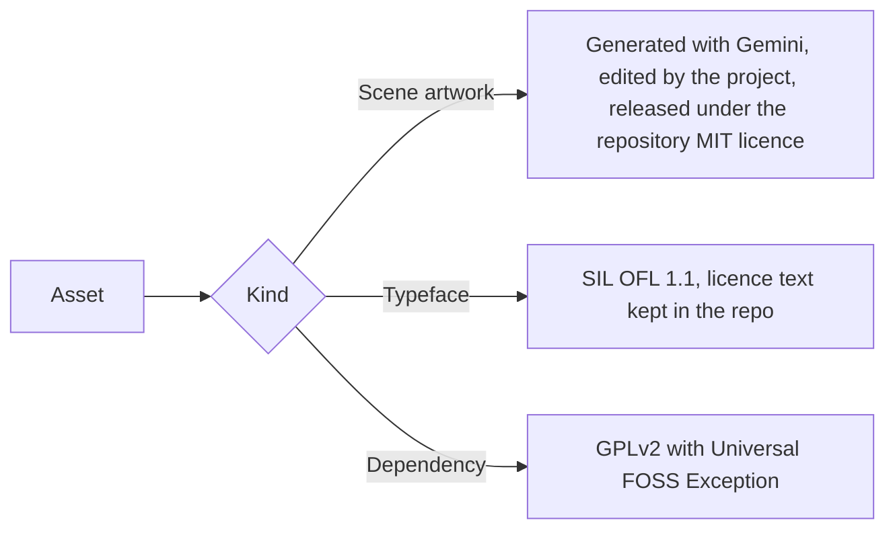

# Third-party assets and licences

Every asset shipped in this repository that is not original project work, with its source and licence. The Code Quests mark, lockups, banners, header strips and social preview are original work of the project and are not listed.

## Scene artwork

The scene images in `frontend/src/assets/scene/` were generated by the project author with Google Gemini in November 2026. The project then edited them: background removal, trimming, resizing, seam repair on the tiling images and conversion to WebP. They were not hand-drawn.

The scene images are released under the repository's MIT licence, see [`LICENSE`](../LICENSE).

This is the author's understanding of Google's terms as of 2026-11-06, not legal advice. The [Google Terms of Service](https://policies.google.com/terms) and the [Generative AI Prohibited Use Policy](https://policies.google.com/terms/generative-ai/use-policy) state that Google does not claim ownership of content a user generates, and that generated output must not be presented as made solely by a human. This project follows the second point by saying openly, above, that the images were generated and then edited.

| Files | Contents |
| --- | --- |
| `board-planks`, `frame-beam`, `frame-corner`, `chain` | The wooden board, its frame, the iron corner brackets and the chain |
| `sign-plank`, `rope-coil` | The hanging title sign and the coil of rope |
| `scratches-1`, `scratches-2`, `ink-blot-1` to `ink-blot-3` | Knife cuts in the wood and ink stains |
| `parchment-tall`, `parchment-wide`, `paper-map`, `paper-sword-shield` | The quest papers, the form paper and the decorative papers |
| `nail-flush`, `nail-half`, `nail-bent`, `nail-angled`, `pin-brass`, `dagger-stuck` | The fasteners |
| `button-wood`, `button-parchment`, `button-brass`, `wax-seal` | The nine-slice buttons and the score seal |
| `torch-unlit`, `lantern-unlit`, `candle-unlit`, `inkwell-quill` | The night props |
| `flame-strip-screen`, `candle-flame-strip-screen` | The flame animation strips |

## Typefaces

| Asset | Source | Licence | Licence text in the repo |
| --- | --- | --- | --- |
| Cinzel, by the Cinzel Project Authors | https://github.com/google/fonts/tree/main/ofl/cinzel | SIL Open Font License 1.1 | [`frontend/src/assets/fonts/Cinzel-OFL.txt`](../frontend/src/assets/fonts/Cinzel-OFL.txt) and [`docs/assets/brand/fonts/Cinzel-OFL.txt`](assets/brand/fonts/Cinzel-OFL.txt) |
| Alegreya Sans (Regular, Medium, Bold), by the Alegreya Sans Project Authors | https://github.com/google/fonts/tree/main/ofl/alegreyasans | SIL Open Font License 1.1 | [`frontend/src/assets/fonts/AlegreyaSans-OFL.txt`](../frontend/src/assets/fonts/AlegreyaSans-OFL.txt) |

The web app serves both typefaces from its own origin, as WOFF2 files in `frontend/src/assets/fonts/`. Each file is the upstream font from the `google/fonts` repository, subset to Latin and converted to WOFF2 with fontTools, with no other change. Cinzel is the variable font, so one file covers every weight. The wordmark and the taglines in `docs/assets/brand/` are Cinzel glyphs converted to outlined paths, so those SVG files need no font. The licence texts are kept next to the fonts as the OFL asks.

## Original work

The Code Quests mark, the lockups, the banners, the header strips and the social preview in `docs/assets/brand/` were made for this project and are published under the same licence as the repository.

## Dependencies with a copyleft licence

`mysql-connector-j` is licensed under the GPLv2 with the Universal FOSS Exception. The project uses it unmodified, as a runtime dependency of the backend, and does not copy or alter its source.
