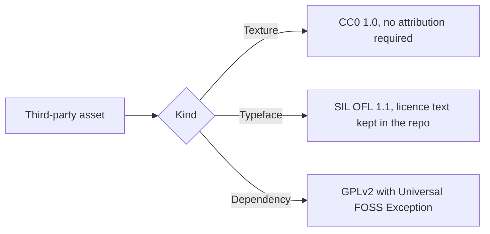

# Third-party assets and licences

Every third-party asset shipped in this repository, with its source and licence. The Code Quests mark, lockups, banners, header strips and social preview are original work of the project and are not listed as third-party.

## Textures

All textures come from ambientCG, which publishes every asset under the Creative Commons CC0 1.0 Universal licence (https://ambientcg.com/license). The 1K colour map of each asset was downscaled to 512x512, its tone was adjusted per pixel to sit on the brand palette (the tiles stay seamless), and it was encoded as WebP. No attribution is required, and it is given here anyway.

| File | Asset | Asset id | Source | Licence |
| --- | --- | --- | --- | --- |
| `frontend/src/assets/textures/wood-dark.webp` | Wood 028 | `Wood028` | https://ambientcg.com/a/Wood028 | CC0 1.0 |
| `frontend/src/assets/textures/parchment.webp` | Paper 006 | `Paper006` | https://ambientcg.com/a/Paper006 | CC0 1.0 |
| `frontend/src/assets/textures/leather.webp` | Leather 028 | `Leather028` | https://ambientcg.com/a/Leather028 | CC0 1.0 |

## Typefaces

| Asset | Source | Licence | Licence text in the repo |
| --- | --- | --- | --- |
| Cinzel, by the Cinzel Project Authors | https://github.com/google/fonts/tree/main/ofl/cinzel | SIL Open Font License 1.1 | [`frontend/src/assets/fonts/Cinzel-OFL.txt`](../frontend/src/assets/fonts/Cinzel-OFL.txt) and [`docs/assets/brand/fonts/Cinzel-OFL.txt`](assets/brand/fonts/Cinzel-OFL.txt) |
| Alegreya Sans (Regular, Medium, Bold), by the Alegreya Sans Project Authors | https://github.com/google/fonts/tree/main/ofl/alegreyasans | SIL Open Font License 1.1 | [`frontend/src/assets/fonts/AlegreyaSans-OFL.txt`](../frontend/src/assets/fonts/AlegreyaSans-OFL.txt) |

The web app serves both typefaces from its own origin, as WOFF2 files in `frontend/src/assets/fonts/`. Each file is the upstream font from the `google/fonts` repository, subset to Latin and converted to WOFF2 with fontTools, with no other change. Cinzel is the variable font, so one file covers every weight. The wordmark and the taglines in `docs/assets/brand/` are Cinzel glyphs converted to outlined paths, so those SVG files need no font. The licence texts are kept next to the fonts as the OFL asks.

## Original work

The Code Quests mark, the lockups, the banners, the header strips and the social preview in `docs/assets/brand/` were made for this project and are published under the same licence as the repository.

## Dependencies with a copyleft licence

`mysql-connector-j` is licensed under the GPLv2 with the Universal FOSS Exception. The project uses it unmodified, as a runtime dependency of the backend, and does not copy or alter its source.
