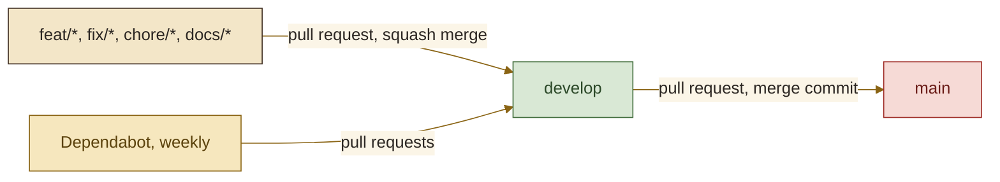

<picture>
  <source media="(prefers-color-scheme: dark)" srcset="assets/brand/header-strip-dark.png, assets/brand/header-strip-dark@2x.png 2x">
  
</picture>

# CI

Three jobs stand between a branch and `main`: the backend build with its coverage gate, the frontend checks with a dependency audit, and a light check of the showcase scripts.

## Branch flow

Work happens on typed branches (`feat/`, `fix/`, `chore/`, `docs/`, `refactor/`, `test/`) cut from `develop`. Feature pull requests are squash-merged into `develop`, so each one leaves a single conventional commit. `develop` is promoted to `main` with a merge commit, so both branches keep the same commits. Dependabot pull requests also target `develop`.



The README's CI badge points at `main`, so it turns green after the first promotion.

## The workflow

One file, `.github/workflows/ci.yml`, named `CI`.

| Item | Value |
|---|---|
| Triggers | `push` and `pull_request` on `main` and `develop` |
| Permissions | `contents: read` |
| Concurrency | One run per workflow and ref; a newer push cancels the older run |
| Runner | `ubuntu-latest` |

| Job | Directory | Steps |
|---|---|---|
| `backend` | `backend` | Temurin 25 with the Gradle cache, then `./gradlew build --no-daemon`: compile, every test including the Testcontainers ones on the runner's Docker, and the 85 percent JaCoCo gate |
| `frontend` | `frontend` | Node 26 with the npm cache, `npm ci`, `lint`, `format:check`, `typecheck`, `test` (Vitest with the 70 percent gate), `build`, and `npm audit --audit-level=low` |
| `showcase scripts` | `e2e/showcase` | Node 26, `npm ci`, `npm run check` (syntax of the capture scripts) and `npm audit --audit-level=low` |

The captures never run in CI, because they need a stack and a browser. The third job installs the pinned dependencies, checks that the scripts parse and audits them.

> [!NOTE]
> `npm audit --audit-level=low` fails on any advisory of any severity, development dependencies included, so a new advisory can turn CI red without a code change. The target is zero advisories.

Before pushing, the local equivalent is:

```bash
cd backend && ./gradlew build --no-daemon
cd ../frontend && npm run lint && npm run format:check && npm run typecheck && npm test && npm run build && npm audit --audit-level=low
cd ../e2e/showcase && npm run check && npm audit
```

## Dependabot

`.github/dependabot.yml` runs five ecosystems weekly, targeting `develop`, with the commit prefix `chore(deps)`. Minor and patch updates are grouped into one pull request per ecosystem, and major updates arrive on their own.

| Ecosystem | Directory |
|---|---|
| gradle | `/backend` |
| npm | `/frontend` |
| github-actions | `/` |
| docker | `/backend` |
| docker | `/frontend` |

The Dockerfiles pin their base images by full tag and the compose files pin `mysql:8.4.13`, so an image bump is a visible diff. The showcase scripts' npm dependencies are covered by the audit step rather than by Dependabot.

## Branch protection

When `main` and `develop` are protected, the required checks are the job names `backend`, `frontend` and `showcase scripts`. Renaming a job in the workflow detaches the rule, so change both together.

---

[Back to the README](../README.md) · Previous: [Testing](TESTING.md) · Next: [API](API.md)
