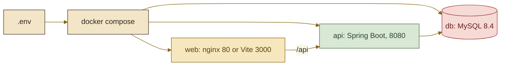

<picture>
  <source media="(prefers-color-scheme: dark)" srcset="assets/brand/header-strip-dark.png, assets/brand/header-strip-dark@2x.png 2x">
  
</picture>

# Environment

Every variable, the compose services and networks, the trusted proxy chain, and the ways to run the stack: production-like, development, outside Docker, and the demo.



## Variables

`.env.example` lists the names. Copy it to `.env`, fill it in and keep it out of git: the repository ignores every `.env*` file except the example. Compose reads `.env` for the production file; the development flow reads `.env.development`.

### In `.env.example`

| Variable | Required | Default | Purpose |
|---|---|---|---|
| `MYSQL_DATABASE` | yes | none | Database name |
| `MYSQL_ROOT_PASSWORD` | yes | none | Root password of the database container |
| `MYSQL_USER` | yes | none | Application database user |
| `MYSQL_PASSWORD` | yes | none | Application database password |
| `VOTER_HASH_SECRET` | yes | none | HMAC key for voter ids. At least 32 bytes, or the API refuses to start. `openssl rand -base64 48` makes one. Changing it orphans every stored vote |
| `TRUSTED_EDGE_PROXIES` | no | empty | Outer proxies (addresses or CIDR, `/8` or longer for IPv4, `/16` or longer for IPv6, comma or space separated) allowed to state the visitor address. An invalid entry stops `web`. Empty trusts nobody. Production file only |
| `TRUSTED_PROXIES` | no | the `app_net` subnet minus its gateway | Regular expression matched against the address connecting to the API. Outside compose a blank value stops the API, but the compose files use `${TRUSTED_PROXIES:-...}`, which replaces a blank value with the default. Change it together with `APP_NET_SUBNET` |
| `APP_NET_SUBNET` | no | `172.29.240.0/24` (production), `172.29.241.0/24` (development) | Subnet of the network between `web` and `api`. Pick a free range when the default overlaps a VPN or another stack |
| `VITE_SITE_URL` | no | blank | Public origin of the site, baked into the Open Graph and Twitter image URLs when the web image is built. Blank leaves those tags out. It is read at build time, so changing it needs `docker compose build web` |

### Set by compose for the API

| Variable | Value |
|---|---|
| `DB_URL` | `jdbc:mysql://db:3306/${MYSQL_DATABASE}` |
| `DB_USERNAME`, `DB_PASSWORD` | From `MYSQL_USER` and `MYSQL_PASSWORD` |
| `SPRING_PROFILES_ACTIVE` | `dev` in the development file; passed through when set in the production file |

### Optional tuning

Compose forwards only the first group to the API. To set another variable inside compose, add it to the `api` service's `environment`. Outside Docker every one of them is read from the shell.

<details>
<summary>Variables the compose files forward</summary>

| Variable | Default | Purpose |
|---|---|---|
| `RATE_LIMIT_CREATE_CAPACITY` | 5 | Quests a client may post per window |
| `RATE_LIMIT_CREATE_WINDOW` | `10m` | The window, as a Spring duration |
| `RATE_LIMIT_VOTE_CAPACITY` | 30 | Vote writes per window |
| `RATE_LIMIT_VOTE_WINDOW` | `1m` | The window |
| `CORS_ALLOWED_ORIGINS` | empty (CORS off) | Comma separated origins allowed on `/api/**` |

</details>

<details>
<summary>Variables read by the API only when set in its own environment</summary>

| Variable | Default | Purpose |
|---|---|---|
| `RATE_LIMIT_MAX_TRACKED_CLIENTS` | 10000 | Clients tracked per scope before eviction |
| `DB_POOL_MAX_SIZE` | 10 | Hikari maximum pool size |
| `DB_POOL_MIN_IDLE` | 2 | Hikari minimum idle connections |
| `DB_POOL_CONNECTION_TIMEOUT_MS` | 5000 | Hikari connection timeout |
| `DB_POOL_MAX_LIFETIME_MS` | 1740000 | Hikari maximum connection lifetime |
| `DB_SLOW_QUERY_THRESHOLD_MS` | 500 | Statements slower than this log under `org.hibernate.SQL_SLOW` |
| `SERVER_PORT` | 8080 | The compose healthchecks and the nginx upstream assume 8080 |
| `MAX_HTTP_REQUEST_HEADER_SIZE` | `16KB` | Tomcat |
| `MAX_HTTP_FORM_POST_SIZE` | `64KB` | Tomcat |
| `MAX_SWALLOW_SIZE` | `64KB` | Tomcat |
| `SERVER_TOMCAT_MAX_CONNECTIONS` | 1000 | Tomcat |
| `SERVER_TOMCAT_ACCEPT_COUNT` | 100 | Tomcat |
| `SERVER_TOMCAT_CONNECTION_TIMEOUT` | `10s` | Tomcat |
| `MVC_ASYNC_REQUEST_TIMEOUT_MS` | 30000 | Spring MVC async timeout |
| `API_PROXY_TARGET` | `http://localhost:8080` | Where the Vite dev server forwards `/api` (read by `frontend/vite.config.ts`) |

</details>

## Compose services

Both compose files define `db`, `api` and `web`, the volume `code_quests_db` and the networks below.

| Service | Production file | Development file |
|---|---|---|
| `db` | `mysql:8.4.13`, host port `3307`, healthcheck with `mysqladmin ping` | The same |
| `api` | Builds `./backend` (layered jar, non-root user). Published on `127.0.0.1:8080` only. Healthcheck on `/manage/health`. Waits for `db` to be healthy | Builds `./backend` with `Dockerfile.dev` (`./gradlew bootRun`), mounts `backend/src`, runs with the `dev` profile |
| `web` | Builds `./frontend` (nginx). `expose: 80`, no published port. Waits for `api` to be healthy | Builds `./frontend` with `Dockerfile.dev` (Vite on port 3000), mounts `./frontend` |

| Network | Subnet | Members | Notes |
|---|---|---|---|
| `app_net` | `APP_NET_SUBNET` | `api`, `web` | Fixed so `TRUSTED_PROXIES` can name it. The gateway (`.1`) is the host side of published ports and is excluded from the default regex |
| `db_net` | Docker default | `db`, `api` | Only the API reaches the database |
| `prnetwork` | Docker default, named `prnetwork` | `web` (production file only) | Where an outer reverse proxy attaches |

The two stacks use different subnets but both publish host ports `3307` and `8080`, so they cannot run at the same time.

## The trusted proxy chain

Three settings decide whose word the API takes about the visitor's address. They form a chain, and the chain is only as strong as its weakest link.

| Setting | Read by | Trusts |
|---|---|---|
| `TRUSTED_EDGE_PROXIES` | nginx in `web` | The outer proxies that may state the visitor address. Empty: nobody, and the client address is the TCP peer |
| `TRUSTED_PROXIES` | Tomcat in `api` | The peer that may state it to the API: by default only the web container, never the gateway, so a request through the loopback port mapping cannot spoof it |
| `APP_NET_SUBNET` | compose | The network both of the above are written against |

> [!IMPORTANT]
> Behind an outer proxy, set `TRUSTED_EDGE_PROXIES` to that proxy's own address, never to a shared subnet: trusting a subnet lets any other container on it forge `X-Forwarded-For`. Left empty behind a proxy, every visitor shares the proxy's identity and its rate limit.

## Run it

### Production-like

```bash
cp .env.example .env
docker compose up -d --build
```

The `web` container publishes no port, so nothing answers on `localhost` yet. To open it on your own machine, create a `docker-compose.override.yml` next to the compose file. Compose merges it automatically, so the command above stays the same, and the file stays local to your clone (do not commit it):

```yaml
services:
  web:
    ports:
      - "127.0.0.1:8081:80"
```

Then open http://localhost:8081. With `TRUSTED_EDGE_PROXIES` empty, nginx takes the connecting address as the visitor, which is right for a direct connection. In a real deployment an outer proxy attaches to `prnetwork` instead and terminates TLS, because nginx here serves plain HTTP.

The API is on `http://localhost:8080` (loopback only). The actuator lives under `/manage` and exposes only `health` and `info`; Swagger is off in this profile.

### Development

Create `.env.development` with the same names as `.env.example`, then:

```bash
./start-dev.sh
```

The script runs `docker compose --env-file .env.development -f docker-compose.development.yml up`, and extra arguments pass through, so `./start-dev.sh db api` starts only the database and the API. The site is at http://localhost:3000 (Vite, strict port) and the API at http://localhost:8080. The `dev` profile turns on Swagger UI at `http://localhost:8080/swagger-ui.html`, the OpenAPI document at `/api-docs` and full stack traces in the log.

In this stack every browser reaches Vite through Docker's published port, so the API sees the Docker gateway as the visitor and the rate limits are shared.

### Outside Docker

Backend, with JDK 25 (the Gradle wrapper downloads Gradle itself). Start MySQL with `./start-dev.sh db`, then from `backend/`:

```bash
DB_URL=jdbc:mysql://localhost:3307/<database> DB_USERNAME=<user> DB_PASSWORD=<password> \
VOTER_HASH_SECRET=<at least 32 bytes> SPRING_PROFILES_ACTIVE=dev ./gradlew bootRun
```

On PowerShell set the same values with `$env:NAME = "value"` and run `.\gradlew.bat bootRun`. `TRUSTED_PROXIES` defaults to loopback, which is right when Vite on the host proxies from `127.0.0.1`. `./gradlew bootJar` builds `build/libs/app.jar`.

Frontend, with Node `^22.12.0 || ^24.0.0 || >=26.0.0` (CI and the Docker images run Node 26 LTS), from `frontend/`: `npm ci`, then `npm run dev` (port 3000, proxying `/api` to `http://localhost:8080` unless `API_PROXY_TARGET` says otherwise). `npm run build` type-checks and builds into `frontend/dist`, and `npm run preview` serves it.

### The demo stack

The screenshots come from a throwaway stack whose API runs with the `demo` profile. From the repository root, with an env file kept outside the repository:

```bash
docker compose -p code-quests-showcase --env-file <your-env-file> \
  -f docker-compose.yml -f e2e/showcase/docker-compose.demo.yml up -d --build
```

The override adds `SPRING_PROFILES_ACTIVE=demo` and `DEMO_SEED_CONFIRM=wipe` to the API, publishes only the web container on `127.0.0.1:8095`, drops the host ports of the database and the API, and moves the stack to `172.29.250.0/24` so it can run beside the development stacks. The seeder wipes the data at every start, so both opt-ins are required and the root compose files never pass the confirmation through. Stop it with the same command and `down -v`. The capture steps are in [TESTING.md](TESTING.md#the-showcase-pipeline).

---

[Back to the README](../README.md) · Previous: [Architecture](ARCHITECTURE.md) · Next: [Testing](TESTING.md)
