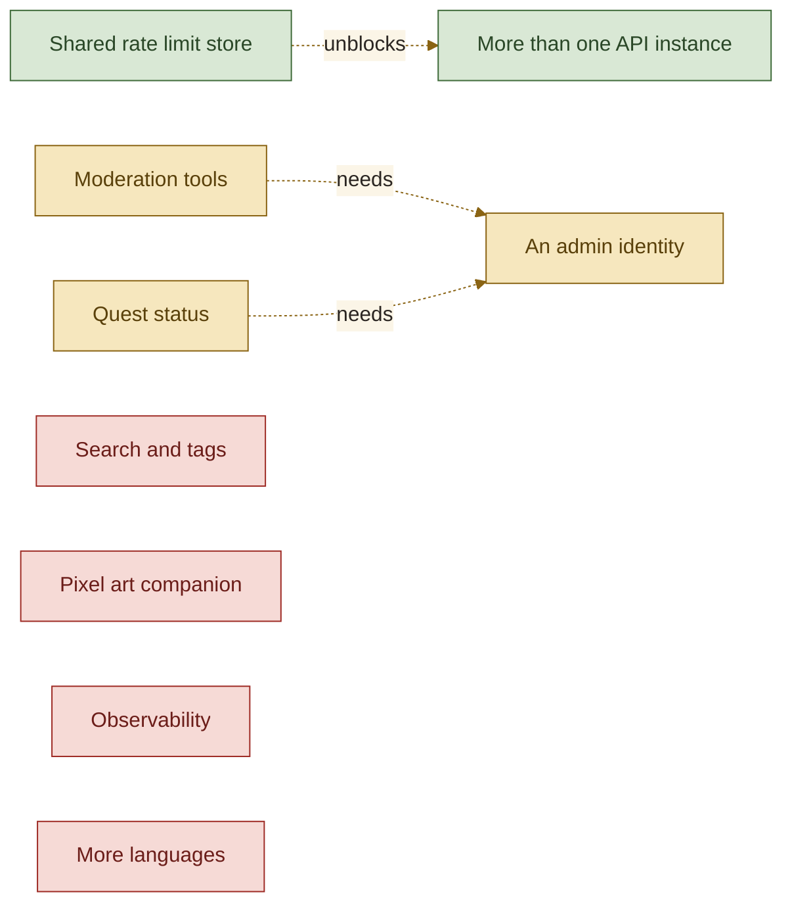

<picture>
  <source media="(prefers-color-scheme: dark)" srcset="assets/brand/header-strip-dark.png, assets/brand/header-strip-dark@2x.png 2x">
  
</picture>

# Roadmap

Quests for the quest board itself: what each one would add, why it is not on the board yet, and what it needs before work starts.

Nothing here is promised or scheduled. Each entry was weighed and left out of the current scope, and stays here so the reasoning is not lost.

## Quests on the horizon

### A shared rate limit store

Rate limits live in memory, so each API instance counts on its own and a restart forgets everyone. That is fine for one instance behind an edge limit. A second instance would need a shared store, Redis being the obvious one, behind the existing `RateLimiter` seam. It waits for a reason to run more than one instance.

### Moderation tools

Quests are public the moment they are posted. A small moderation path (hide, edit, remove) would keep the board tidy if it ever draws a crowd. It needs an admin identity, which the project deliberately does not have, so it waits for that decision.

### Quest status

A quest could move from posted to in progress to slain, with a link to the finished project, closing the loop between an idea and what was built from it. It needs the admin identity above, a migration (`V3`) and a place for the status on the parchment.

### Search and tags

With enough quests the board stops being skimmable. A text search and a few tags would help, either with MySQL full-text indexes or a tag table. It waits until the list is long enough to need it.

### Observability

The API logs a request id on every line and exposes health and info. Metrics (request rates, rate limit denials, vote conflicts) through Micrometer and a dashboard would show how the board behaves under real traffic. It needs somewhere to send them.

### A pixel art companion

A pixel art gallery would be a project of its own rather than a page inside the board. It needs a separate repository and a reason to link the two.

### More languages

The interface and the API messages are in English. The API already resolves its locale from the `Accept-Language` header and keeps its messages in a bundle, so a second bundle is the backend half of it. The frontend would need a message catalogue and a language switch.

---

[Back to the README](../README.md) · Previous: [API](API.md)
