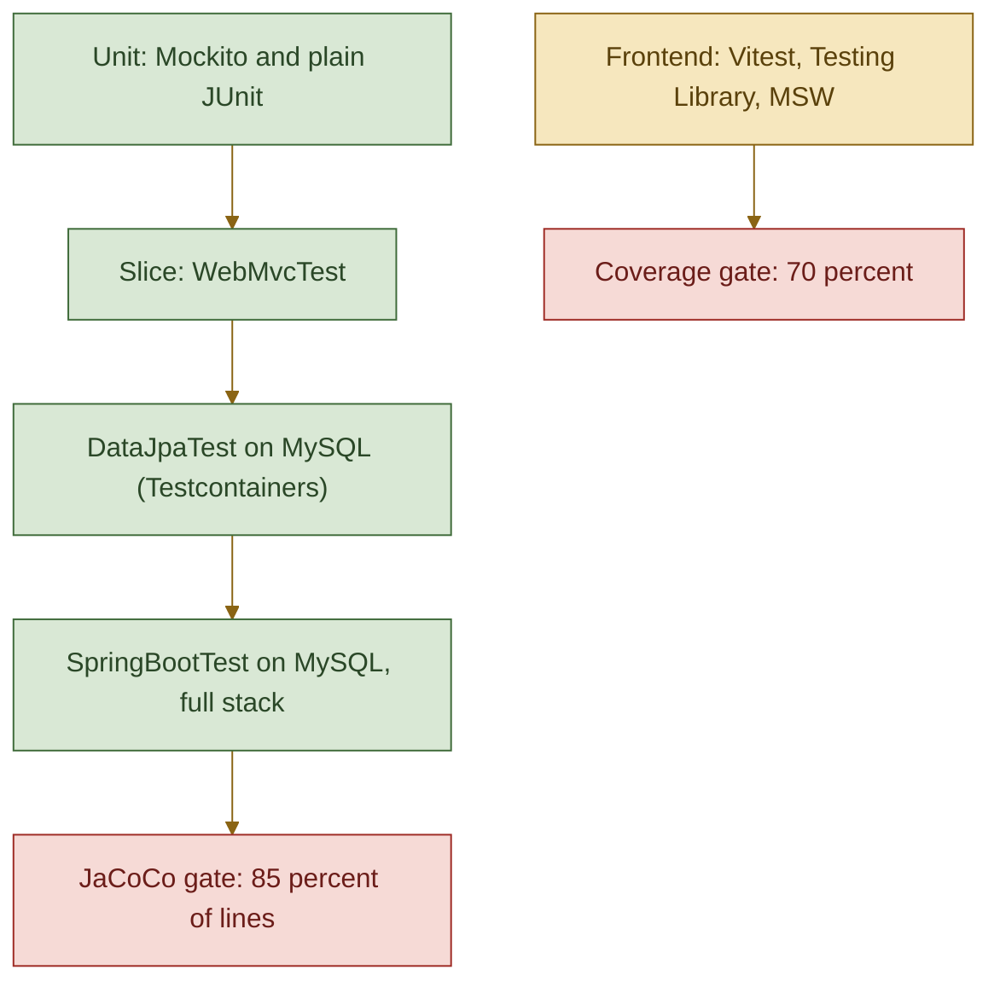
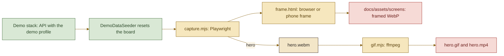

<picture>
  <source media="(prefers-color-scheme: dark)" srcset="assets/brand/header-strip-dark.png, assets/brand/header-strip-dark@2x.png 2x">
  
</picture>

# Testing

The backend runs unit, slice and real-database tests behind an 85 percent line gate. The frontend runs Vitest with Testing Library and MSW behind a 70 percent gate. The screenshots have their own reproducible pipeline.



## Backend

JUnit 5, Mockito, AssertJ, Spring test slices and Testcontainers. Run from `backend/`; on PowerShell use `.\gradlew.bat`.

| Level | What it covers | Needs Docker |
|---|---|---|
| Unit with Mockito | Handler, service, rate limit interceptor | No |
| Plain unit | Mapper, sort whitelist, rate limiter, address normaliser, identity resolver, voter hasher, secure logger, filters, security headers, property validation, exception handler | No |
| Config contract | `ComposeTrustedProxyDefaultTest` reads both compose files and checks that the `TRUSTED_PROXIES` default trusts the subnet minus the gateway and nothing else | No |
| `@WebMvcTest` | The HTTP contract, validation errors, ProblemDetail shapes, CORS on and off | No |
| `@DataJpaTest` on MySQL | Repositories and the constraints, with the real Flyway migrations | Yes |
| `@SpringBootTest` on MySQL | The API end to end on a random port, both trusted and untrusted proxy chains, 12 concurrent voters on one idea, the demo seeder and its profile isolation | Yes |
| Migration upgrade | `FlywayUpgradeFromV1IntegrationTest` migrates to V1, inserts legacy rows, then upgrades to the latest version | Yes |

### Testcontainers

`MySqlIntegrationSupport` starts one `mysql:8.4.13` container per JVM, shared by every subclass and stopped when the JVM exits. Datasource properties are injected with `@DynamicPropertySource` and Flyway runs the production migrations, so the tests see the production schema. The upgrade test starts its own container because it needs a schema that stops at V1. A running Docker daemon is required for the rows above; without it those classes fail at initialisation while the unit and slice tests still run. The first run pulls the image, so it is slower.

### The 85 percent gate

`jacocoTestReport` runs after every `test`. `jacocoTestCoverageVerification` requires at least 85 percent of lines and is wired into `check`, so `./gradlew build` fails below it while `./gradlew test` alone does not check it. The application class is excluded. The HTML report is at `backend/build/reports/jacoco/test/html/index.html`.

| Goal | Command |
|---|---|
| Everything CI runs, gate included | `./gradlew build --no-daemon` |
| Tests only | `./gradlew test` |
| One class | `./gradlew test --tests "com.feuerschvenger.codequests.service.IdeaServiceImplTest"` |

> [!WARNING]
> Never run two Gradle builds on the same build directory at once, whether two terminals or an IDE next to a terminal. Each rewrites `backend/build` and the locks, and the results corrupt each other.

## Frontend

Vitest with `happy-dom`, Testing Library (`react`, `dom`, `user-event`, `jest-dom`) and MSW for HTTP. Tests sit next to the code as `*.test.ts(x)`. Run from `frontend/`.

| Piece | Where |
|---|---|
| Config | `vitest.config.ts` merges `vite.config.ts`, so the `@` alias works. Four workers, 15 second timeout |
| Setup | `src/test/setup.ts`: jest-dom matchers, stubs for `matchMedia`, `ResizeObserver`, `document.fonts` and `scrollIntoView`, MSW in strict mode, and cleanup after each test |
| MSW | `src/test/server.ts`, with `onUnhandledFrame: 'error'`, so a request without a handler fails the test |
| Suites | The app, the list and its masonry layout, the form, the state components, every hook, the HTTP client and error mapping, the services, the scene (lighting maths, flicker timer, layout events), the parchment, the wax seal, the header, the footer, the logo, the theme, and the build plugins for social meta and font preload |
| Asset check | `social-preview.test.ts` asserts the two copies of the social preview are byte-identical |

Coverage uses `v8` and reports text, HTML and lcov into `frontend/coverage` (ignored by git). Lines, functions, branches and statements must each reach 70 percent, and `npm test` fails below it.

| Goal | Command |
|---|---|
| Everything CI runs | `npm run lint`, `npm run format:check`, `npm run typecheck`, `npm test`, `npm run build`, `npm audit --audit-level=low` |
| Watch mode | `npm run test:watch` |
| One file | `npx vitest run src/hooks/useVote.test.tsx` |

The static gates are ESLint 10 with `typescript-eslint` type-checked rules and the React hooks rules, Prettier, and `tsc -b` with `strict` and `noUncheckedIndexedAccess`.

<details>
<summary>Gotchas worth knowing</summary>

- The notification store of Mantine is module-level, so a test that shows a notification leaks it into the next one. `setup.ts` calls `notifications.clean()` after each test; keep it there.
- happy-dom lacks `matchMedia`, `ResizeObserver` and `document.fonts`, which Mantine needs. The stubs live in `setup.ts`.
- `.gitattributes` forces LF line endings except for `*.bat`, so shell scripts keep working after a Windows checkout.

</details>

## The showcase pipeline

The screenshots and the hero animation are produced by a script, so they can be retaken after every change and always show the product with the same data. The full guide is [`e2e/showcase/README.md`](../e2e/showcase/README.md); this is the shape of it.



```bash
cd e2e/showcase
npm ci
npm run install:browsers
BASE_URL=http://localhost:8095 npm run capture
FFMPEG=<path to ffmpeg> npm run hero
FFMPEG=<path to ffmpeg> npm run gif
```

- **Same data every time.** The demo seeder wipes and reloads twelve quests at each API start. Before a browser opens, the script asserts the board is the demo board.
- **Stills never write.** Every still aborts any non-GET request to `/api` and fails the shot if one was attempted. The validation shot fills fields that fail validation, so nothing is sent.
- **Same picture every time.** Stills use a 1600 by 1000 window at twice the pixel density (1040 high for the two top shots, so the whole form fits), phone shots use 390 by 844, each in its own browser context with the colour scheme stored before the first paint. Each shot asserts that fonts are loaded, images decoded, no skeleton or notice is on screen, no animation is mid flight, and at night that a flame is drawn and lit.
- **The hero is smooth.** It is recorded in full Chromium, because the default headless shell rasterises in software and drops frames. `gif.mjs` builds a GIF up to 1100 pixels wide at 20 frames a second under 8 MB (it tries 1100, 1040 and 980 until the file fits) with a two pass palette, an MP4 at 25 frames a second, measures distinct frames with ffmpeg's `mpdecimate`, and fails below 20 a second in the scroll glide. Each file is replaced atomically.
- **Hero guard.** The hero posts one quest and one vote, so it accepts a `BASE_URL` on loopback only. Restart the API to reseed afterwards, and take the stills before the hero.
- **In CI** only the syntax of the scripts is checked and their dependencies are audited, because the captures need a stack and a browser. `DemoConstantsSyncTest` keeps the quest constants in `capture.mjs` equal to the seeder's.

---

[Back to the README](../README.md) · Previous: [Environment](ENVIRONMENT.md) · Next: [CI](CI.md)
