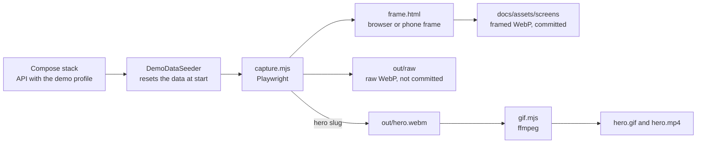

# Showcase captures

The screenshots and the hero animation of Code Quests are produced by a script, not by hand. `capture.mjs` drives a running stack with a real browser and takes each shot, so the pictures always show the product as it is, with the same data, the same window size and the same frame. `gif.mjs` turns the recorded hero flow into a GIF and an MP4 and measures how smooth the MP4 is.



## Prerequisites

- Docker with Compose v2. The override file uses the `!override` tag, which the Compose file merge reference documents but does not date, so no minimum version is claimed. The stack was tested with Docker Compose v2.40.3 (Docker Engine 29.1.2).
- Node `^22.12.0 || >=24.0.0`.
- Playwright and its Chromium: from this folder run `npm ci` and `npm run install:browsers`. The hero needs the full Chromium build that `install:browsers` installs, not only the headless shell.
- ffmpeg for `gif.mjs`. Install it with `winget install Gyan.FFmpeg`, `brew install ffmpeg` or `apt install ffmpeg`, and point `FFMPEG` at the executable when it is not on the PATH. It needs libx264.

## Start the demo stack

The captures run against a stack whose API was started with the Spring profile `demo`. At every start that profile deletes all ideas and votes and loads the demo quests, which is what makes the shots reproducible. The seeder needs two opt-ins and a local database. The profile alone is not enough: it also refuses to run unless `DEMO_SEED_CONFIRM=wipe` is set (property `demo.seed.confirm`), and it refuses unless the datasource host is `localhost`, `127.0.0.1`, `::1` or `db`. Without the confirmation the API fails at startup with a message that says so and deletes nothing, so a stray `SPRING_PROFILES_ACTIVE=demo` on a normal stack, whose database host is `db`, cannot erase real data. Only `e2e/showcase/docker-compose.demo.yml` sets the confirmation. The root compose files never pass it through, and it must not go in any env file of a stack that holds real data.

From the repository root, put the usual variables in an env file kept outside the repository, then start the stack under its own project name with the override in this folder:

```bash
docker compose -p code-quests-showcase --env-file <your-env-file> \
  -f docker-compose.yml -f e2e/showcase/docker-compose.demo.yml up -d --build
```

The env file needs `MYSQL_DATABASE`, `MYSQL_ROOT_PASSWORD`, `MYSQL_USER`, `MYSQL_PASSWORD` and `VOTER_HASH_SECRET` (at least 32 bytes), and optionally `SHOWCASE_PORT`. The values only need to exist: the database is a throwaway volume of this project. The override sets `SPRING_PROFILES_ACTIVE=demo` and `DEMO_SEED_CONFIRM=wipe` on the API, publishes only the web container on `127.0.0.1:8095`, drops the host ports of the database and the API, and moves the stack to the subnet `172.29.250.0/24` so it can run beside the development stacks. Change the subnet and the `TRUSTED_PROXIES` line together when that range is taken.

Without the override the root `docker-compose.yml` is unchanged: `SPRING_PROFILES_ACTIVE` is passed through only when it is set in the environment, so a normal stack never runs the seeder.

Stop the stack with the same command and `down -v`, which removes only the containers, network and volume of that project.

## Run it

From this folder:

```bash
npm ci
BASE_URL=http://localhost:8095 npm run capture
FFMPEG=<path to ffmpeg> npm run hero
FFMPEG=<path to ffmpeg> npm run gif
```

`npm run capture` takes every still. `npm run hero` records the hero flow and `npm run gif` converts it. The script prints `OK` or `FAIL` for each shot and exits non-zero when any failed.

| Variable | Default | Meaning |
|---|---|---|
| `BASE_URL` | `http://localhost:8095` | The site to capture. Requests to `/api` go through it. Point it only at the demo stack |
| `SHOWCASE_ALLOW_REMOTE` | unset | Set to `1` to let the hero run against a `BASE_URL` that is not on loopback |
| `SLUGS` | Every still | A comma separated list of slugs. A slug may also be passed as an argument |
| `SHOWCASE_OUT` | `docs/assets/screens` | Where the framed stills and the animation are written. The raw stills always go to `out/raw` in this folder |
| `SHOWCASE_FRAME_SCALE` | `1.25` | The pixel density of the framed shots |
| `SHOWCASE_WEBP_QUALITY` | `0.88` | WebP quality of the stills, from 0 to 1 |
| `FFMPEG` | `ffmpeg` | The ffmpeg executable, read by `gif.mjs` |

## The shots

| Slug | Shows | Output |
|---|---|---|
| `top-day` | The top of the page by day: the hanging title sign, the tagline, the intro plank and the post-a-quest form | `top-day.framed.webp` |
| `top-night` | The same top by night, with the torch and the lantern lit at a bright moment of their flicker | `top-night.framed.webp` |
| `board-day` | The quest board by day, with the first quests and their wax seals | `board-day.framed.webp` |
| `board-night` | The same board by night, with the fire lit | `board-night.framed.webp` |
| `quest-expanded` | A long quest opened with Read more | `quest-expanded.framed.webp` |
| `post-quest-errors` | The post-a-quest form with its validation errors | `post-quest-errors.framed.webp` |
| `voting-rules` | The voting rules modal at night | `voting-rules.framed.webp` |
| `mobile-day` | The board on a 390 by 844 phone by day | `mobile-day.framed.webp` |
| `mobile-night` | The same phone by night | `mobile-night.framed.webp` |
| `hero` | At night: post a quest, see it pinned on the board, back it, and watch the wax seal stamp the new score | `hero.gif`, `hero.mp4` |

## How the shots stay the same

- Stills use a 1600 by 1000 window at twice the pixel density, except `top-day` and `top-night`, which use 1600 by 1040. The post-a-quest form ends about 25 pixels below a 1000 pixel window, so those two windows are 40 pixels taller to keep the whole form, its button included, in the picture. The window is resized rather than the capture cropped, because the fixed lighting layers cover only the window. The mobile shots use 390 by 844, at twice the density, with touch emulation. The framed version of each is rendered from `frame.html`: a light or dark browser window showing the address `code-quests.local`, or a phone for the mobile shots.
- Every shot runs in its own browser context, with the color scheme stored before the first paint, so no state leaks from one shot to the next.
- Before any browser opens, the script asserts that the board is the demo board: 12 quests, the newest one first. Each shot then asserts that the demo quests render, that no skeleton, loader or notice is on screen, that the web fonts are loaded, that the images in view are decoded and that no animation is mid flight. Night shots also assert that a flame is drawn and lit.
- The stills write nothing to the product. The validation shot fills a name and a quest that fail validation, so the browser never sends the request. A route on `**/api/**` at the context level of every still aborts any request that is not a GET and fails the shot if one was attempted. Stills never write.
- Captures must point only at the demo stack. The hero posts a quest and a vote, so it accepts a `BASE_URL` whose host is exactly `localhost`, `127.0.0.1` or `[::1]`. Any other spelling, such as `127.0.0.2` or `localhost.`, is refused unless `SHOWCASE_ALLOW_REMOTE=1` is set, and that variable is for a host that is itself a throwaway demo stack.
- The hero posts one quest and one vote. After it the board is no longer the demo board, so the next run of `capture.mjs` stops at the first check. Restart the API to reseed it: `docker compose -p code-quests-showcase --env-file <your-env-file> -f docker-compose.yml -f e2e/showcase/docker-compose.demo.yml restart api`. Run the stills before the hero when both are needed.
- The hero is recorded in the full Chromium build at 1280 by 800. The default headless shell rasterizes in software and drops frames on a scene this heavy.
- `gif.mjs` encodes into `out/` and copies the GIF and the MP4 to `docs/assets/screens` only after the size and smoothness checks pass. When a check fails it exits non-zero and leaves the committed files untouched.
- A hero run deletes `out/hero.webm`, `out/hero.json` and any partial video before it records, and writes `out/hero.started`. `gif.mjs` refuses to convert when the recording is missing or older than that marker, so a failed run can never publish the previous animation.
- `gif.mjs` builds the GIF at 20 frames a second and 1100 pixels wide with a two pass palette, trying larger palettes first and narrower pictures only when no palette fits, until it is under 8 MB. It encodes the MP4 at 25 frames a second.
- Smoothness is measured on the MP4 with `ffmpeg -i hero.mp4 -vf mpdecimate,showinfo -f null -`, which keeps only the frames that differ from their predecessor. `gif.mjs` prints the distinct frames in each second, the figure for the stretch where the page scrolls to the board and the figure for the stretch where the seal is stamped, and fails when the scroll stretch has fewer than 20 distinct frames a second. The pauses of the clip, where only a flame flickers, count as repeats for that filter, so the whole clip averages lower.

## Maintenance

- Rerun the commands when a change alters a screen, and commit the framed stills and the hero with the change. The raw stills in `out/raw` are not committed: the folder is ignored, and they exist only to inspect a shot before it is framed.
- A new shot is one more entry in `SHOTS` in `capture.mjs`: a slug, an address for the frame, a color scheme and a function that brings the page to the state to photograph.
- The demo quests live in `backend/src/main/java/com/feuerschvenger/codequests/demo/DemoQuests.java`. The constants at the top of `capture.mjs` mirror the headline quest, the long quest and the quest count, and must change with it.
- `npm run check` runs `node --check` on both scripts.
